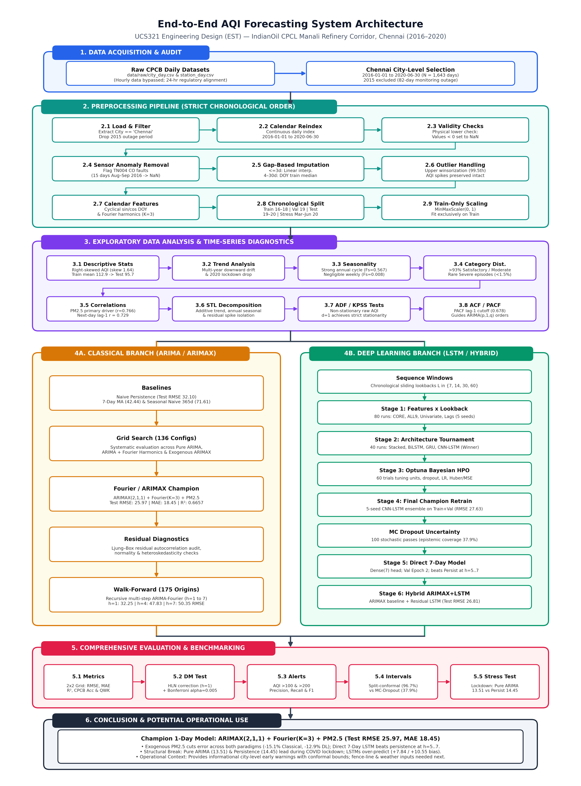
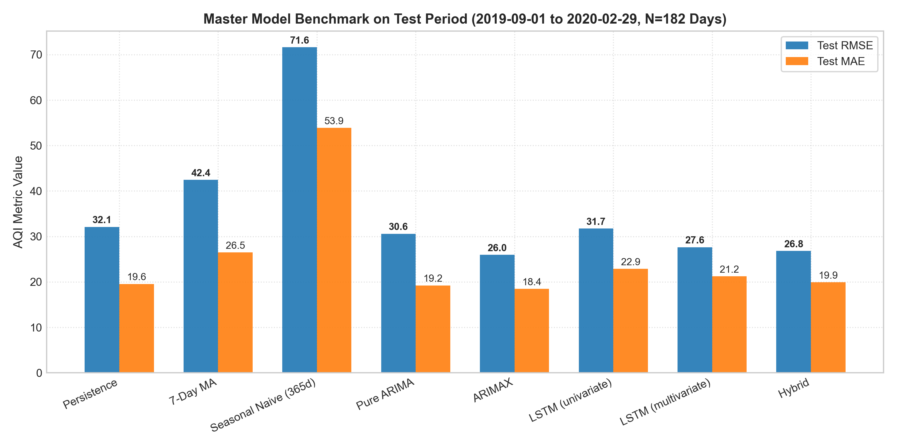
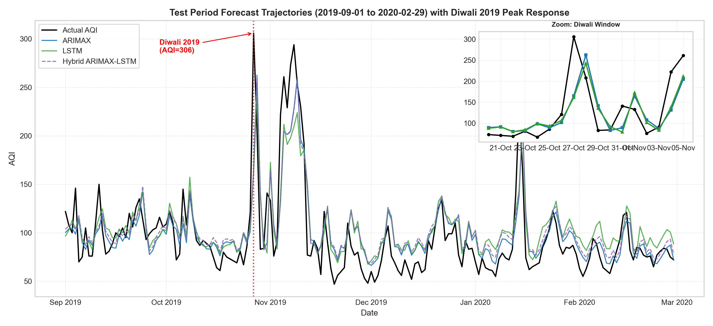
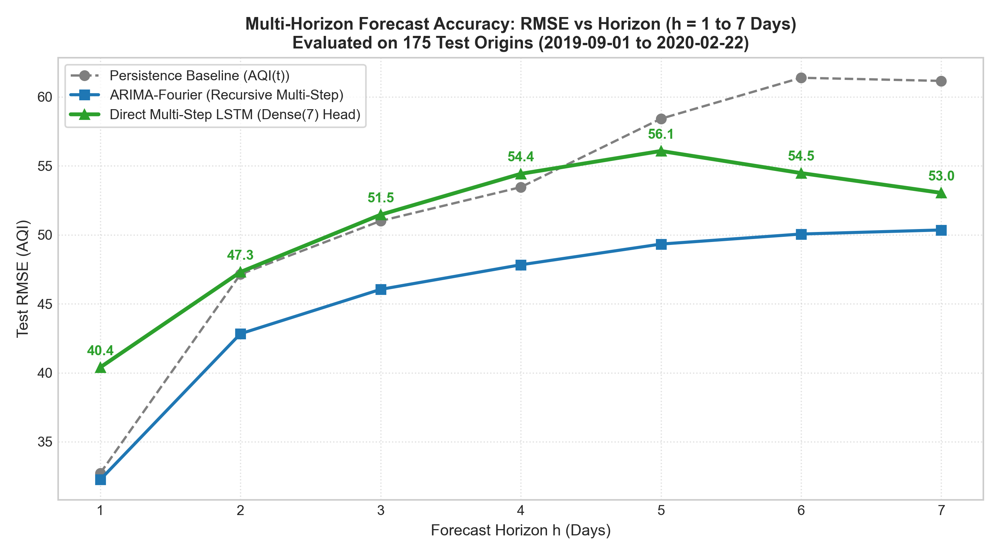

# Air Quality Index (AQI) Forecasting Around IndianOil Refinery Zones
**UCS321 Engineering Design / EST Course Project — Thapar Institute of Engineering & Technology**

An end-to-end time-series forecasting benchmark comparing **Classical State-Space Models (ARIMA / ARIMAX + Fourier)**, **Deep Learning Sequence Architectures (LSTM / CNN-LSTM)**, and **Residual Hybrid Ensembles** for predicting daily Air Quality Index (AQI) around the Chennai Petroleum Corporation Limited (CPCL) Manali refinery corridor in Chennai, India (2016–2020). Built with leakage-free chronological splitting, Bayesian hyperparameter optimization, Harvey–Leybourne–Newbold corrected Diebold–Mariano testing, split-conformal uncertainty quantification, and a held-out COVID-19 lockdown structural-break stress test.

---

## Problem Statement

> *"Indian Oil Corporation seeks to forecast the Air Quality Index (AQI) around its refinery zones. Using historical pollutant levels, an ARIMA and LSTM-based forecasting model is needed to predict AQI values and support proactive emission control."*

Refining operations emit regulated criteria air pollutants including particulate matter ($\text{PM}_{2.5}$), nitrogen oxides ($\text{NO}_x$), sulfur dioxide ($\text{SO}_2$), and carbon monoxide ($\text{CO}$). Using daily Central Pollution Control Board (CPCB) ambient monitoring records for Chennai (`2016-01-01` to `2020-06-30`, $N = 1,643$ days; 2015 excluded due to an 82-day monitoring outage), this project evaluates 1-day ahead ($h=1$) and 7-day ahead ($h=1\dots 7$) forecasting accuracy across four chronological partitions: **Train** (2016–2018, $N=1,096$), **Validation** (Jan–Aug 2019, $N=243$), **Test** (Sep 2019–Feb 2020, $N=182$), and **Stress Test** (Mar–Jun 2020 COVID-19 lockdown, $N=122$).

---

## Headline Results (Test Period: `2019-09-01` to `2020-02-29`, $N=182$ Days)

All metrics are computed on unscaled AQI values; authoritative figures across all splits and horizons are catalogued in [`docs/FINAL_NUMBERS.md`](docs/FINAL_NUMBERS.md).

| Model Family | Model Description | Test RMSE | Test MAE | Test $R^2$ | CPCB Accuracy | QWK |
| :--- | :--- | :---: | :---: | :---: | :---: | :---: |
| **Baseline** | Naive Daily Persistence ($AQI_t$) | 32.10 | 19.56 | 0.4889 | 73.63% | 0.5951 |
| **Classical** | Pure ARIMA(2,1,1) | 30.58 | 19.23 | 0.5362 | 74.18% | 0.5587 |
| **Classical Champion** | **ARIMAX(2,1,1) + Fourier(K=3) + PM2.5** | **25.97** | **18.45** | **0.6657** | **76.92%** | **0.6471** |
| **Deep Learning** | Univariate Stacked LSTM (Lookback=7) | 31.73 | 22.87 | 0.5008 | 70.88% | 0.5226 |
| **Deep Learning Champion** | CNN-LSTM (Lookback=7, Core features) | 27.63 | 21.21 | 0.6214 | 68.68% | 0.5384 |
| **Ensemble Hybrid** | Hybrid ARIMAX + Residual LSTM | 26.81 | 19.91 | 0.6435 | 74.73% | 0.6296 |

*(Additional Test baselines in `FINAL_NUMBERS.md`: 7-Day Moving Average RMSE = 42.44, MAE = 26.49; Seasonal Naive 365d RMSE = 71.61, MAE = 53.86.)*

---

## Key Visual Summaries

### 1. End-to-End Pipeline Architecture


### 2. Master Model Benchmark (Test Period)


### 3. Test Forecast Trajectory Overlay (with Diwali 2019 Zoom Inset)


### 4. Multi-Horizon Forecast Accuracy ($h = 1$ to $7$ Days, 175 Origins)


---

## Key Findings

1. **Classical ARIMAX Outperformed Deep Learning on Day-Ahead Forecasting**: ARIMAX(2,1,1)+Fourier(K=3)+PM2.5 achieved the lowest Test RMSE (**25.97**) and MAE (**18.45**), outperforming CNN-LSTM (27.63 / 21.21), Hybrid ARIMAX+LSTM (26.81 / 19.91), Pure ARIMA (30.58 / 19.23), and Persistence (32.10 / 19.56).
2. **Statistical Significance (HLN-Corrected Diebold–Mariano & Bonferroni Adjustment)**: At the unadjusted $\alpha = 0.05$ threshold, ARIMAX significantly outperformed Persistence ($p = 0.0132$), Pure ARIMA ($p = 0.0297$), CNN-LSTM ($p = 0.0127$), and Hybrid ($p = 0.0001$), while CNN-LSTM vs Persistence was not significant ($p = 0.0758$). Applying a conservative Bonferroni correction across 10 pairwise tests ($\alpha_{\text{adj}} = 0.005$), only ARIMAX vs Hybrid remains statistically significant ($p = 0.0001$).
3. **Exogenous $\text{PM}_{2.5}$ Information Drives Accuracy Across Both Paradigms**: Adding exogenous $\text{PM}_{2.5}$ to classical ARIMA lowered Test RMSE by **15.1%** ($30.58 \to 25.97$); adding the core pollutant suite (`[PM2.5, CO, O3, NO2, SO2]`) to univariate LSTM lowered Test RMSE by **12.9%** ($31.73 \to 27.63$).
4. **Multi-Horizon 7-Day Tradeoff (Leakage-Free Epoch Selection)**: Retraining epochs for the Direct Multi-Step `Dense(7)` LSTM were chosen strictly on Validation without test leakage (mean validation RMSE across horizons minimized at **Epoch 2**, 33.88). Evaluated on 175 identical origins, the 7-day LSTM beats Persistence only at horizons $h \in [5, 6, 7]$ ($56.08$ vs $58.42$; $54.48$ vs $61.38$; $53.04$ vs $61.16$), whereas Persistence and recursive ARIMA-Fourier lead at $h \in [1\dots 4]$. Recursive ARIMA-Fourier achieves the lowest RMSE at $h=2\dots 6$, consistent with the hypothesis that deterministic seasonal harmonics constrain multi-day trajectory dispersion.
5. **COVID-19 Lockdown Structural Break (`2020-03-01` to `2020-06-30`, Mean AQI = 78.81)**: Pure ARIMA achieved the lowest stress RMSE (13.51), followed by persistence (14.45); models using exogenous or seasonal terms (ARIMAX 17.74, multivariate CNN-LSTM 20.28) performed worst, with the LSTMs over-predicting (mean bias +7.84 / +10.55) and ARIMAX under-predicting (−8.32).
6. **Spike Under-Prediction & Worst-Day Calendar Audit**: Across the top 10% highest AQI test days ($\text{AQI} \ge 134.9$, $N=19$), every model exhibited negative forecast bias ($-27.6$ to $-55.5$ AQI). Auditing the top 5 worst-forecast days showed that **2 of the 5 worst days** correspond to calendar-verified festivals (Diwali on `2019-10-27`, actual AQI 306, error $-140.8$; and Bhogi on `2020-01-14`, actual AQI 230, error $-92.2$), while the remaining 3 days had no matched calendar event.
7. **Uncertainty Quantification (Split-Conformal vs MC Dropout)**: Distribution-free split-conformal intervals ($q = 63.87$ for ARIMAX, $q = 57.71$ for LSTM) attained empirical test coverages of **96.70%** and **96.15%** (**98.36%** on Stress), though theoretical marginal guarantees assume exchangeability which time series with drift do not strictly satisfy. In contrast, 100-pass Monte Carlo dropout covered only **37.91%** on Test because it captures epistemic uncertainty alone.
8. **Potential Operational Use**: Day-ahead ARIMAX(2,1,1)+F3+PM2.5 forecasts coupled with split-conformal intervals can serve as an informational early-warning input (Test AQI > 100: Precision 64.5%, Recall 76.9%, F1 = 0.702; Test AQI > 200: Precision 85.7%, Recall 60.0%, F1 = 0.706 across 10 rare event days). Because underlying CPCB records represent city-level ambient air quality rather than fence-line perimeter monitors, outputs reflect regional conditions rather than isolated CPCL Manali refinery emissions.

---

## Repository Structure

```text
.
├── data/
│   ├── raw/                       # Raw CPCB CSVs (git-ignored; download via data/raw/README.md)
│   │   └── README.md              # Kaggle dataset download and file placement guide
│   └── processed/                 # Imputed, upper-winsorized datasets & chronological splits
│       ├── chennai_clean_full.csv # Complete audited series (2016-01-01 to 2020-06-30, N=1,643)
│       ├── train.csv, val.csv, test.csv, stress.csv
│       └── train_scaled.csv, val_scaled.csv, test_scaled.csv, stress_scaled.csv
├── notebooks/                     # Executed, self-contained phase notebooks
│   ├── 02_data_audit.ipynb        # Phase 2: Missingness audit & station/city selection
│   ├── 03_preprocessing.ipynb     # Phase 3: Anomaly removal, imputation, winsorization, scaling
│   ├── 04_eda.ipynb               # Phase 4: STL decomposition, correlations, stationarity
│   ├── 05_arima.ipynb             # Phase 5: Baselines, ARIMA/ARIMAX grid search, diagnostics
│   ├── 06_lstm.ipynb              # Phase 6: Factorial grid, CNN-LSTM, Optuna HPO, Hybrid
│   └── 07_evaluation.ipynb        # Phase 7: Master benchmark, DM tests, alerts, stress test
├── src/                           # Core Python modules, notebook builders & pipeline runners
│   ├── metrics.py                 # Regression, CPCB categories, QWK & DM test utilities
│   ├── sequences.py               # Chronological sequence windowing & scaler loaders
│   ├── models_dl.py               # Keras Stacked LSTM, BiLSTM, GRU & CNN-LSTM builders
│   ├── train_dl.py                # Phase 6 end-to-end DL pipeline runner (Stages 1–7)
│   ├── retrain_7day.py            # Validation-selected Epoch 2 direct 7-day LSTM retraining
│   ├── train_univariate_lstm.py   # Univariate LSTM baseline training script
│   ├── run_phase7.py              # Master evaluation, conformal intervals & Phase 7 figures
│   ├── draw_flow_diagram.py       # Generates flow_diagram.png & flow_diagram_compact.png
│   ├── check_consistency.py       # Automated data/metric/documentation consistency audit
│   ├── build_phase*_notebook.py / create_notebook_07.py  # Reproducible notebook generators
│   └── dev/                       # Phase 1 & helper utilities (check_env, data_inventory, update_docs)
├── outputs/
│   ├── figures/                   # 300-DPI figures (flow diagrams + p2_* to p7_*)
│   ├── models/                    # Saved weights/scalers (< 25 MB, tracked for reproducibility)
│   └── results/                   # Evaluation CSVs, prediction logs, Optuna DB & DM matrices
├── docs/
│   ├── FINAL_NUMBERS.md           # Single frozen source of truth for all headline metrics
│   ├── RESULTS_SUMMARY.md         # Concise executive summary of factual findings
│   ├── PROJECT_LOG.md             # Cumulative Phase 1–7 technical audit log
│   ├── FLOW_DIAGRAM.md            # Textual sequence and Mermaid system architecture
│   └── FIGURE_INDEX.md            # Complete index of generated project figures
├── CLAUDE.md                      # Project governance, locked decisions & workflow rules
├── requirements.txt               # Pinned Python 3.11 dependencies
└── README.md
```

---

## Environment Setup

- **Python**: **Python 3.11.0 (64-bit)** (required for TensorFlow 2.16 CPU & NumPy 1.26 binary compatibility).

```powershell
# 1. Create and activate virtual environment (Windows PowerShell)
py -3.11 -m venv .venv
.\.venv\Scripts\Activate.ps1

# 2. Install pinned dependencies
python -m pip install --upgrade pip setuptools wheel
pip install -r requirements.txt

# 3. Register the Jupyter kernel
python -m ipykernel install --user --name ucs321-aqi --display-name "Python (ucs321-aqi)"
```

*(On Linux/macOS, substitute `python3.11 -m venv .venv` and `source .venv/bin/activate`.)*

---

## Data Download

Raw CSV files are excluded from Git tracking due to size limits. Follow [`data/raw/README.md`](data/raw/README.md) to download **Air Quality Data in India (2015–2020)** by Vopani from Kaggle and place `city_day.csv`, `station_day.csv`, and `stations.csv` into `data/raw/`.

---

## How to Reproduce

Execute the notebooks and training scripts strictly in order from the repository root:

```powershell
# 1. Data Audit & Preprocessing
jupyter nbconvert --to notebook --execute --inplace notebooks/02_data_audit.ipynb
jupyter nbconvert --to notebook --execute --inplace notebooks/03_preprocessing.ipynb

# 2. Exploratory Data Analysis & Classical Time-Series Modeling
jupyter nbconvert --to notebook --execute --inplace notebooks/04_eda.ipynb
jupyter nbconvert --to notebook --execute --inplace notebooks/05_arima.ipynb

# 3. Deep Learning Pipeline (Factorial Grid, Architecture Tournament, Optuna HPO, Hybrid & 7-Day)
python src/train_dl.py
python src/retrain_7day.py
python src/train_univariate_lstm.py
jupyter nbconvert --to notebook --execute --inplace notebooks/06_lstm.ipynb

# 4. Final Benchmarking, Statistical Testing, Figures & Verification
python src/run_phase7.py
python src/draw_flow_diagram.py
jupyter nbconvert --to notebook --execute --inplace notebooks/07_evaluation.ipynb
python src/check_consistency.py
```

---

## Limitations

1. **City-Level vs Fence-Line Resolution**: CPCB daily data captures Chennai city-wide ambient air quality rather than dedicated fence-line sensors along the CPCL Manali refinery perimeter.
2. **Absence of Meteorological Predictors**: Planetary boundary layer height, wind speed/direction, humidity, and thermal inversion metrics were unavailable in the dataset.
3. **Episodic Event & Severe-Spike Sparsity**: Only 10 days in the 182-day Test window exceeded AQI 200 (5.5%), and unmodeled cultural pyrotechnic events (Diwali, Bhogi) cause sharp spikes without explicit calendar event indicators.

---

## Course & Credits

- **Institution**: Thapar Institute of Engineering & Technology (TIET), Patiala
- **Course**: UCS321 — EST Project (November 2026)
- **Group**: Group 2W1
- **Members**: Arush Saini (`1025230031`), Jiya Wadhwa (`1025230094`), Darsh Marwaha (`1025230032`), Tahoor (`1025230126`), Arshita Doomra (`1025230123`)
