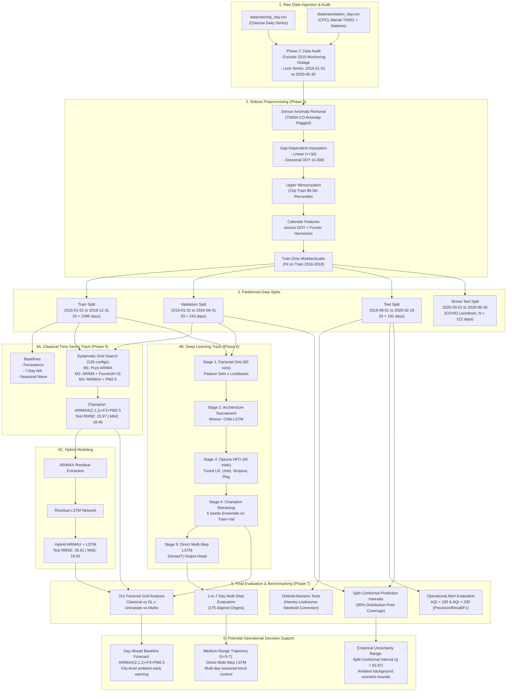

# Project Workflow & Architecture Flow Diagram
**UCS321 Engineering Design (EST) — IndianOil AQI Forecasting**

---

## 1. End-to-End Execution Sequence

1. **Phase 1: Environment & System Initialization**
   - Host system check: Windows 11, PowerShell 5.1, Git 2.54.
   - Python selection: Python 3.11.0 64-bit environment (`.venv`) for TensorFlow 2.16 stability.
   - Kernel registration: `ucs321-aqi` Jupyter kernel.
   - Raw data inventory: Audited 26 city files and 130 station monitoring files.
2. **Phase 2: Data Audit & Location Selection**
   - Location selection: Chennai selected (CPCL Manali Refinery zone, an IndianOil subsidiary).
   - Granularity: Daily series (`city_day.csv`), ignoring hourly files.
   - Outage discovery: 82-day monitoring outage discovered in Sep–Nov 2015.
   - Locked start date: 2016-01-01 (excluding the 2015 monitoring outage).
   - Locked splits: Train (2016-01-01 → 2018-12-31), Val (2019-01-01 → 2019-08-31), Test (2019-09-01 → 2020-02-29), Stress (2020-03-01 → 2020-06-30).
3. **Phase 3: Robust Preprocessing Pipeline**
   - Date range enforcement: 2016-01-01 to 2020-06-30 ($N=1643$ days).
   - Validity checks: Physical negative clipping at 0.0.
   - Sensor anomaly removal: Flagged TN004 CO sensor failure (19–22 Sep 2016) and set to NaN.
   - Gap-dependent imputation: Linear interpolation for short gaps ($\le 3$ days); seasonal day-of-year median for medium gaps (4–30 days).
   - Upper-bound winsorization: Capped at training 99.5th percentile (no lower clipping).
   - Cyclical calendar encoding: $\sin$ and $\cos$ of day-of-year ($2\pi \cdot \text{DOY}/365.25$).
   - Strict temporal scaling: Scikit-learn `MinMaxScaler(0,1)` fit on Train only, transforming Val, Test, and Stress.
4. **Phase 4: Exploratory Data Analysis & Feature Verification**
   - Temporal decomposition: STL and classical additive decomposition revealing strong annual cyclicity.
   - Correlation analysis: $\text{PM}_{2.5}$ identified as primary driver of AQI ($r = 0.766$, lag-1 $r = 0.729$).
   - Calendar spike table: Diwali and Bhogi verified as primary spike drivers.
   - Station vs City consistency: Validated CPCL Manali monitoring station (TN001) alignment with city index.
5. **Phase 5: Classical Time Series Modeling (ARIMA / ARIMAX)**
   - Baselines: Naive persistence, 7-day moving average, 365-day seasonal naive.
   - Stationarity verification: ADF test confirmed stationarity after first differencing ($d=1$).
   - Systematic grid search: Evaluated 136 configurations across M1 (pure ARIMA), M2 (ARIMA+Fourier), and M3 (ARIMAX).
   - Champion selection: Final $\text{ARIMAX}(2,1,1) + \text{Fourier}(K=3) + \text{PM}_{2.5}$ achieving Test RMSE 25.97.
   - Multi-horizon recursive testing: Evaluated across 175 rolling origins.
6. **Phase 6: Deep Learning Recurrent Architectures (LSTM)**
   - Stage 1 Factorial Grid: 80 runs evaluating 4 feature sets $\times$ 4 lookbacks $\times$ 5 seeds.
   - Stage 2 Architecture Tournament: 40 runs comparing Stacked LSTM, Bidirectional LSTM, GRU, and Conv1D-LSTM. Winning architecture: CNN-LSTM.
   - Stage 3 Bayesian Optimization: Optuna 60-trial HPO tuning units, dropouts, learning rate, batch size, regularization.
   - Stage 4 Champion Retraining: 5-seed ensemble retrained on Train+Val with MC-dropout uncertainty.
   - Stage 5 Direct Multi-Step: Direct multi-output `Dense(7)` head retrained with 5 seeds.
   - Stage 6 Hybrid Modeling: ARIMAX + Residual LSTM model.
   - Stage 7 Stress Evaluation: Evaluated on COVID lockdown structural break.
7. **Phase 7: Final Evaluation, Hypothesis Testing & Industrial Synthesis**
   - $2 \times 2$ Grid Analysis: Classical vs DL $\times$ Univariate vs Multivariate.
   - Master benchmark: Consolidated comparison across all models on Val, Test, Stress.
   - Diebold–Mariano testing: HLN small-sample corrected pairwise p-value matrix.
   - Operational alerts: Precision, recall, and F1 at AQI > 100 and AQI > 200.
   - Uncertainty quantification: Split-conformal calibrated 95% prediction intervals.
   - Potential operational use: Early warning context, uncertainty bounds, and limitations of city-level data for refinery decision support.

---

## 2. Mermaid System Architecture Flowchart

