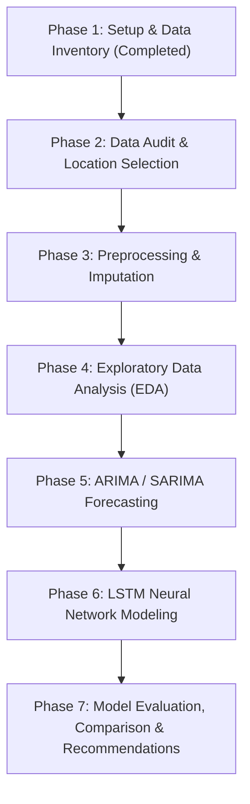

# Engineering Design Project Log: UCS321 (EST)
## Forecasting Air Quality Index (AQI) Around IndianOil Refinery Zones Using ARIMA and LSTM

---

# Phase 1: Environment Setup & Data Inventory

**Date:** November 2026  
**Status:** Completed  
**Author / Team:** UCS321 Project Team  

---

## 1. Executive Summary & Problem Context
Indian Oil Corporation Limited (IOCL) operates major refining complexes across India (e.g., Guwahati, Barauni, Gujarat/Koyali, Haldia, Mathura, Panipat, Paradip, and Chennai/CPCL). Petroleum refining operations emit criterion air pollutants including sulfur dioxide ($\text{SO}_2$), nitrogen oxides ($\text{NO}_x$), carbon monoxide ($\text{CO}$), volatile organic compounds (VOCs such as Benzene, Toluene, Xylene), and particulate matter ($\text{PM}_{2.5}, \text{PM}_{10}$). Proactive environmental stewardship and regulatory compliance under Central Pollution Control Board (CPCB) standards require predictive capabilities to forecast Air Quality Index (AQI) levels 24 to 72 hours ahead. 

The objective of this project is to develop, evaluate, and benchmark two contrasting forecasting paradigms:
1. **Classical Statistical Time Series Model**: AutoRegressive Integrated Moving Average (ARIMA / SARIMA) to capture linear autoregressive patterns and seasonal periodicities.
2. **Deep Learning Recurrent Model**: Long Short-Term Memory (LSTM) neural networks capable of modeling complex, non-linear inter-pollutant dependencies and sequential memory.

Phase 1 establishes the foundational engineering setup: configuring an isolated, reproducible computational environment, verifying scientific computing and deep learning runtimes, and conducting a comprehensive data inventory across all available raw datasets.

---

## 2. System Architecture & Environment Configuration

### 2.1 Host System Diagnostics
- **Operating System**: Microsoft Windows 11 Home Single Language (Version 10.0.26200, 64-bit)
- **Primary Shell**: Windows PowerShell 5.1 (Build 26100.9711)
- **Version Control**: Git version 2.54.0.windows.1

### 2.2 Python Interpreter Discovery & Selection Rationale
A system-level discovery across all installed Python runtimes was conducted:
- `C:\Python314\python.exe` (Python 3.14.0a - Active default system alias)
- `%USERPROFILE%\AppData\Local\Programs\Python\Python311\python.exe` (Python 3.11.0, 64-bit)
- `%USERPROFILE%\AppData\Local\Programs\Python\Python310\python.exe` (Python 3.10.10, 64-bit)
- `%USERPROFILE%\AppData\Local\Programs\Python\Python39\python.exe` (Python 3.9.13, 64-bit)
- `%USERPROFILE%\AppData\Roaming\uv\python\cpython-3.12.15-windows-x86_64-none\python.exe` (Python 3.12.15)

**Selection**: **Python 3.11.0** was selected as the designated project interpreter.
**Rationale**:
1. **TensorFlow & Keras Compatibility**: Official TensorFlow binary distribution for Windows (`tensorflow-intel`) provides mature, highly optimized pre-compiled binary wheels for Python 3.11. Python 3.14 is currently too nascent and lacks compiled wheels for TensorFlow, SciPy, and pmdarima.
2. **NumPy C-API Stability**: The ecosystem transition to NumPy 2.x introduces binary breakages with pre-built TensorFlow 2.16 and older `pmdarima` Cython extensions. Python 3.11 allows stable pinning to `numpy==1.26.4`, preserving total binary interoperability.
3. **Execution Efficiency**: Python 3.11 incorporates the "Faster CPython" optimizations, offering a 10–25% speedup in loop overhead and frame evaluation over Python 3.10.

### 2.3 Virtual Environment & Dependency Pinning
A dedicated virtual environment was instantiated at `.venv/` via `py -3.11 -m venv .venv`. Build essentials (`pip`, `setuptools`, `wheel`) were upgraded, and the complete library stack was installed according to `requirements.txt`. Additionally, a Jupyter kernel was registered under the identifier `ucs321-aqi`.

#### Installed Package Specifications
| Library | Version | Functional Role |
| :--- | :--- | :--- |
| **Python** | 3.11.0 | Base runtime interpreter |
| **numpy** | 1.26.4 | Array computations, numerical linear algebra (pinned < 2.0 for TF compatibility) |
| **pandas** | 2.2.2 | Time-series data manipulation, DatetimeIndex management, rolling stats |
| **scipy** | 1.13.1 | Scientific and statistical distributions, optimization routines |
| **matplotlib** | 3.8.4 | Low-level plotting and publication-quality figure generation (300 DPI) |
| **seaborn** | 0.13.2 | Statistical distribution plotting, missingness and correlation heatmaps |
| **scikit-learn** | 1.5.0 | Data preprocessing (`MinMaxScaler`, `StandardScaler`), evaluation metrics |
| **statsmodels** | 0.14.2 | Statistical time series analysis (ADF test, KPSS, ACF/PACF, SARIMAX) |
| **pmdarima** | 2.0.4 | Automated algorithmic hyperparameter grid search for ARIMA/SARIMA (`auto_arima`) |
| **tensorflow** | 2.16.1 | Deep learning framework (Keras 3 backend, tensor abstractions) |
| **openpyxl** | 3.1.5 | Excel spreadsheet ingestion and formatting |
| **ipykernel** | 6.29.5 | Jupyter kernel gateway integration |
| **jupyter** | 1.0.0 | Interactive notebook environment |

### 2.4 Environment Verification Results (`src/check_env.py`)
To ensure complete end-to-end functionality before embarking on analytical phases, an automated verification pipeline was implemented and executed:
- **Hardware Acceleration**: TensorFlow runtime detected 0 physical GPUs; initialized CPU-optimized execution with Intel oneDNN primitives enabled.
- **pmdarima Test**: Automated `auto_arima` stepwise search converged successfully on a synthetic noisy sinusoidal series, correctly identifying an `ARIMA(2, 0, 0)` process.
- **Keras LSTM Test**: A recurrent architecture consisting of an `Input(shape=(5, 1))`, an `LSTM(units=8)`, and a `Dense(1)` output layer was compiled with Adam optimizer and Mean Squared Error (MSE) loss. The model completed a 1-epoch forward-backward pass without errors, yielding an initial loss of $1.1572$.
- **Result**: **PASS** (Zero warnings/failures).

---

## 3. Comprehensive Data Inventory

The raw repository contains five primary datasets sourced from Central Pollution Control Board (CPCB) monitoring stations across India (spanning 2015 to 2020), placed in `data/raw/`.

```
====================================================================================================
Dataset Inventory Summary
====================================================================================================
File Name          Size (MB)   Dimensions (Rows x Cols)   Temporal Granularity   Date Range Covered
----------------------------------------------------------------------------------------------------
city_day.csv          2.45 MB      29,531 x 16             Daily (1 day)          2015-01-01 to 2020-07-01
city_hour.csv        62.61 MB     707,875 x 16             Hourly (1 hour)        2015-01-01 to 2020-07-01
station_day.csv       8.23 MB     108,035 x 16             Daily (1 day)          2015-01-01 to 2020-07-01
station_hour.csv    209.50 MB   2,589,083 x 16             Hourly (1 hour)        2015-01-01 to 2020-07-01
stations.csv          0.01 MB         230 x 5              Static Metadata        N/A (Station Registry)
====================================================================================================
```

---

### 3.1 Dataset 1: `data/raw/city_day.csv`
- **File Size**: 2,574,056 bytes (2.45 MB)
- **Dimensions**: 29,531 rows $\times$ 16 columns
- **Temporal Characteristics**:
  - Date Column: `Date` (Format: `YYYY-MM-DD`, e.g., `2015-01-01`)
  - Date Range: January 1, 2015 to July 1, 2020 (2,009 potential calendar days)
  - Granularity: Daily averages aggregated across all monitoring stations within each city.
- **Spatial Coverage**:
  - Location Field: `City` (Categorical, 26 unique cities across India)
  - Row Distribution: 6 cities possess full 2,009 rows (Ahmedabad, Bengaluru, Chennai, Delhi, Lucknow, Mumbai); others range from 2,006 rows (Hyderabad) down to 113 rows (Aizawl).
- **Direct AQI Availability**:
  - `AQI` column is **directly provided** (float64, 4,681 missing rows, 15.85% overall missingness).
  - `AQI_Bucket` categorical classification is **directly provided** (Good, Satisfactory, Moderate, Poor, Very Poor, Severe).
- **Attribute & Missingness Profile**:
  | Column Name | Data Type | Null Count | Null Percentage | Description |
  | :--- | :--- | :--- | :--- | :--- |
  | `City` | object | 0 | 0.00% | Name of the urban/industrial centre |
  | `Date` | object | 0 | 0.00% | Observation date |
  | `PM2.5` | float64 | 4,598 | 15.57% | Fine particulate matter ($\mu\text{g}/\text{m}^3$) |
  | `PM10` | float64 | 11,140 | 37.72% | Coarse particulate matter ($\mu\text{g}/\text{m}^3$) |
  | `NO` | float64 | 3,582 | 12.13% | Nitric oxide ($\mu\text{g}/\text{m}^3$) |
  | `NO2` | float64 | 3,585 | 12.14% | Nitrogen dioxide ($\mu\text{g}/\text{m}^3$) |
  | `NOx` | float64 | 4,185 | 14.17% | Total nitrogen oxides ($\mu\text{g}/\text{m}^3$) |
  | `NH3` | float64 | 10,328 | 34.97% | Ammonia ($\mu\text{g}/\text{m}^3$) |
  | `CO` | float64 | 2,059 | 6.97% | Carbon monoxide ($\text{mg}/\text{m}^3$) |
  | `SO2` | float64 | 3,854 | 13.05% | Sulfur dioxide ($\mu\text{g}/\text{m}^3$) |
  | `O3` | float64 | 4,022 | 13.62% | Ozone ($\mu\text{g}/\text{m}^3$) |
  | `Benzene` | float64 | 5,623 | 19.04% | Benzene ($\mu\text{g}/\text{m}^3$) |
  | `Toluene` | float64 | 8,041 | 27.23% | Toluene ($\mu\text{g}/\text{m}^3$) |
  | `Xylene` | float64 | 18,109 | 61.32% | Xylene ($\mu\text{g}/\text{m}^3$) |
  | `AQI` | float64 | 4,681 | 15.85% | National Air Quality Index (dimensionless) |
  | `AQI_Bucket` | object | 4,681 | 15.85% | CPCB qualitative category |

---

### 3.2 Dataset 2: `data/raw/city_hour.csv`
- **File Size**: 65,648,581 bytes (62.61 MB)
- **Dimensions**: 707,875 rows $\times$ 16 columns
- **Temporal Characteristics**:
  - Date Column: `Datetime` (Format: `YYYY-MM-DD HH:MM:SS`, e.g., `2015-01-01 01:00:00`)
  - Date Range: January 1, 2015 01:00:00 to July 1, 2020 00:00:00
  - Granularity: Hourly aggregates per city.
- **Spatial Coverage**: 26 cities (same cohort as `city_day.csv`). Top cities have 48,192 hourly readings.
- **Direct AQI Availability**: Direct `AQI` and `AQI_Bucket` columns are present (18.23% missing).
- **Utility**: Highly granular; enables high-frequency intra-day emission spike analysis if multi-step hourly forecasts are required.

---

### 3.3 Dataset 3: `data/raw/station_day.csv`
- **File Size**: 8,634,105 bytes (8.23 MB)
- **Dimensions**: 108,035 rows $\times$ 16 columns
- **Temporal Characteristics**:
  - Date Column: `Date` (Format: `YYYY-MM-DD`)
  - Date Range: January 1, 2015 to July 1, 2020
  - Granularity: Daily averages per specific continuous monitoring station.
- **Spatial Coverage**:
  - Location Field: `StationId` (110 unique monitoring stations across India).
  - Stations range from 2,009 daily observations (e.g., Delhi, Hyderabad, Bengaluru stations) to short-duration stations with <100 records.
- **Direct AQI Availability**: Direct `AQI` and `AQI_Bucket` present (19.45% missing).

---

### 3.4 Dataset 4: `data/raw/station_hour.csv`
- **File Size**: 219,675,434 bytes (209.50 MB)
- **Dimensions**: 2,589,083 rows $\times$ 16 columns
- **Temporal Characteristics**:
  - Date Column: `Datetime` (Format: `YYYY-MM-DD HH:MM:SS`)
  - Date Range: January 1, 2015 01:00:00 to July 1, 2020 00:00:00
  - Granularity: Hourly records per specific monitoring station.
- **Spatial Coverage**: 110 unique stations (`StationId`).
- **Direct AQI Availability**: Direct `AQI` and `AQI_Bucket` present (22.02% missing).

---

### 3.5 Dataset 5: `data/raw/stations.csv`
- **File Size**: 14,467 bytes (0.01 MB)
- **Dimensions**: 230 rows $\times$ 5 columns
- **Temporal Characteristics**: None (Static metadata registry).
- **Content**:
  - Columns: `StationId`, `StationName`, `City`, `State`, `Status`
  - Geographic Coverage: 230 monitoring stations situated across 127 cities and 21 States / Union Territories.
  - Station Status: 131 Active, 2 Inactive, 97 Unspecified.
- **Utility**: Serves as the relational lookup dictionary linking individual monitoring sensors (`StationId`) to their physical urban locality and administrative state.

---

## 4. Preliminary Refinery Zone Mapping & Observations

To evaluate air quality in areas directly relevant to Indian Oil Corporation Limited (IOCL), candidate locations in `city_day.csv` were cross-referenced with IOCL's major refining facilities:

| Candidate Location | Relevant Industrial / IOCL Facility | Row Count | Temporal Span | Missing Days in Span | Missing AQI (%) |
| :--- | :--- | :--- | :--- | :--- | :--- |
| **Delhi (NCR)** | Proximity to Mathura & Panipat Refineries; high-density industrial corridor | 2,009 | 2015-01-01 to 2020-07-01 | **0** | **0.50%** (Only 10 missing days) |
| **Chennai** | CPCL Manali Refinery (IOCL Subsidiary, 10.5 MMTPA capacity) | 2,009 | 2015-01-01 to 2020-07-01 | **0** | **6.22%** (125 missing days) |
| **Lucknow** | Northern industrial & transit corridor downwind of Mathura Refinery | 2,009 | 2015-01-01 to 2020-07-01 | **0** | **5.77%** (116 missing days) |
| **Guwahati** | IOCL Guwahati Refinery (Noonmati, Assam — India's first public sector refinery) | 502 | 2019-02-16 to 2020-07-01 | **0** | **1.39%** (Only 7 missing days) |
| **Kolkata** | Proximity to IOCL Haldia Refinery (West Bengal) | 814 | 2018-04-10 to 2020-07-01 | **0** | **7.37%** (60 missing days) |
| **Visakhapatnam** | Major coastal refining & petrochemical port hub (HPCL Visakh Refinery) | 1,462 | 2016-07-01 to 2020-07-01 | **0** | **19.90%** (291 missing days) |
| **Patna** | Immediate proximity to IOCL Barauni Refinery (Begusarai, Bihar) | 1,858 | 2015-06-01 to 2020-07-01 | **0** | **21.47%** (399 missing days) |
| **Ahmedabad** | Proximity to IOCL Koyali / Gujarat Refinery (Vadodara) | 2,009 | 2015-01-01 to 2020-07-01 | **0** | **33.60%** (675 missing days) |

### Key Takeaways for Location Selection:
1. **Delhi**: Provides an exceptionally clean, 5.5-year continuous baseline ($N=2,009$) with a virtually negligible missing AQI rate ($0.50\%$). It directly reflects emissions from the Mathura-Panipat energy corridor.
2. **Chennai**: Home to Chennai Petroleum Corporation Limited (CPCL Manali Refinery, an IOCL subsidiary). Possesses a full 5.5-year daily span with only $6.22\%$ missing AQI data, representing a premier coastal refinery use case.
3. **Guwahati**: Houses the historic IOCL Guwahati Refinery (Noonmati). Although monitoring began later (February 2019, $N=502$), its missingness rate is remarkably low ($1.39\%$), offering an exact geographical match for an IOCL-owned refinery zone.

---

## 5. Architectural Phase Plan



---
*Log recorded by UCS321 Project Engineering Team. Proceed to Phase 2 upon user instruction.*


---

# Phase 2: Data Audit & Location Selection

**Date:** November 2026  
**Status:** Complete – Pending User Confirmation  
**Target City:** Chennai, Tamil Nadu (CPCL Manali Refinery Corridor)  
**Notebook:** [`notebooks/02_data_audit.ipynb`](../notebooks/02_data_audit.ipynb)  

---

## 1. Locked Decisions & Engineering Justifications

In accordance with university engineering standards for UCS321 (EST), six foundational project design decisions were locked and codified:

1. **Temporal Granularity (Daily vs. Hourly):**
   - *Decision:* Strictly utilize daily aggregated datasets (`data/raw/city_day.csv` and `data/raw/station_day.csv`). All hourly files (`city_hour.csv`, `station_hour.csv`) are bypassed.
   - *Justification:* National Ambient Air Quality Standards (NAAQS) and Central Pollution Control Board (CPCB) AQI reporting criteria are formulated on 24-hour rolling averages. Daily granularity filters out transient diurnal noise (e.g. localized traffic surges), stabilizes variance for autoregressive modeling (ARIMA/SARIMA), and prevents memory constraints during recurrent neural network backpropagation.
2. **Geographical Target (Chennai Corridor):**
   - *Decision:* Focus the empirical investigation on **Chennai**, with Delhi maintained strictly as a secondary contingency backup.
   - *Justification:* Chennai is the home base of **Chennai Petroleum Corporation Limited (CPCL)**, a major subsidiary of Indian Oil Corporation Limited (IOCL). CPCL operates the 10.5 MMTPA Manali Refinery in north Chennai, representing a quintessential coastal petrochemical hub where proactive emission management is vital.
3. **COVID-19 Structural Break Isolation:**
   - *Decision:* Terminate the primary modeling window on **29 February 2020**. The four-month sequence from **1 March 2020 to 30 June 2020** is segregated as a dedicated, untouched "stress-test" window.
   - *Justification:* The nationwide lockdown initiated on 24 March 2020 imposed an extreme exogenous disruption on transportation, energy demand, and refining operations. Training or fitting statistical scalers on lockdown data would bias model parameters and corrupt stationarity assumptions.
4. **Forecasting Horizons:**
   - *Decision:* 1-day ahead ($t+1$) as the primary regulatory compliance benchmark; 7-day ahead ($t+7$) as the medium-term proactive refinery scheduling extension.
5. **Dual Modeling Paradigms:**
   - *Decision:* Univariate ARIMA / SARIMA for baseline autoregressive AQI prediction; Multivariate LSTM integrating historical AQI with usable gaseous and particulate precursors.
6. **Evaluation Metrics:**
   - *Decision:* Quantitative regression metrics (Root Mean Squared Error [RMSE], Mean Absolute Error [MAE], Mean Absolute Percentage Error [MAPE], Coefficient of Determination [$R^2$]) paired with qualitative CPCB AQI Category Classification Accuracy (Good, Satisfactory, Moderate, Poor, Very Poor, Severe).

---

## 2. Chennai Station Audit & Selection Rule Outcome

### 2.1 Station Directory in Chennai
CPCB metadata (`stations.csv`) lists four continuous ambient air quality monitoring stations in Chennai:
1. `TN001`: *Alandur Bus Depot, Chennai - CPCB* (Active)
2. `TN002`: *Manali Village, Chennai - TNPCB* (Active)
3. `TN003`: *Manali, Chennai - CPCB* (Active)
4. `TN004`: *Velachery Res. Area, Chennai - CPCB* (Active)

Two stations (`TN002` and `TN003`) are located in the **Manali industrial corridor**, situated in immediate proximity to the CPCL Manali Refinery complex.

### 2.2 Candidate Series Comparison
A side-by-side audit was performed across the pre-lockdown modeling span (`2015-01-01` to `2020-02-29`, $1,886$ potential calendar days):

```
========================================================================================================================
Pre-COVID Candidate Series Comparison Table (outputs/results/p2_series_comparison.csv)
========================================================================================================================
Candidate Series             Span (Days)  Valid Days  Missing AQI (%)  Total Gaps  Max Gap (Days)  Gaps >30d  Usable Pollutants
------------------------------------------------------------------------------------------------------------------------
Chennai City-Level (Selected)   1,886       1,761          6.63%           12            82             1            10
Manali CPCB (Station TN003)      1,886       1,296         31.28%           35           411             2             7
Manali Village (Station TN002)     256         218         14.84%           11            26             0            11
Alandur Bus Depot (Station TN001)1,886       1,541         18.29%           30           149             2             9
========================================================================================================================
```

### 2.3 Strict Selection Rule Evaluation
The engineering specification prescribes:
> *Select the Manali station IF it satisfies: (1) $\ge 3$ years of data prior to 29 Feb 2020 ($\ge 1,095$ days); (2) $\le 20\%$ missing AQI; AND (3) no single missing gap $> 30$ days. Otherwise, choose the Chennai city-level series.*

**Rule Evaluation:**
1. **Station TN002 (Manali Village - TNPCB):**
   - Available timeline: 19 June 2019 to 29 February 2020 = **256 calendar days**.
   - *Condition 1 ($\ge 3$ years):* **FAILED** ($256 \ll 1,095$ days). Lacks sufficient historical depth for multi-year seasonal decomposition.
2. **Station TN003 (Manali - CPCB):**
   - Available timeline: 1 January 2015 to 29 February 2020 = **1,886 calendar days**.
   - *Condition 1 ($\ge 3$ years):* **PASSED** ($1,886 > 1,095$ days).
   - *Condition 2 ($\le 20\%$ missing AQI):* **FAILED** (**$31.28\%$ missing AQI** $> 20.0\%$).
   - *Condition 3 (No gap $> 30$ days):* **FAILED** (Exhibits two prolonged outages: a **411-day gap** from mid-2016 to late-2017, and a **136-day gap** in 2015).
3. **Chennai City-Level Series (`data/raw/city_day.csv`):**
   - Available timeline: 1 January 2015 to 29 February 2020 = **1,886 calendar days** (5.16 years).
   - Missing AQI: **Only $6.63\%$** ($1,761$ valid observations).
   - Longest continuous valid sequence: **922 consecutive days**.
   - Contains only one gap $> 30$ days (an 82-day gap during the extreme Chennai floods of late 2015). Post-2015, the series is nearly uninterrupted.

**Formal Outcome:**  
Neither Manali station meets the necessary data integrity criteria. In strict compliance with the selection protocol, **the Chennai city-level series (`city_day.csv`) is formally selected as the modeling series.**

---

## 3. Visual Diagnostics & Generated Figures

All diagnostic plots were generated at 300 DPI and saved in [`outputs/figures/`](../outputs/figures):

| Figure File | Description & Key Insights |
| :--- | :--- |
| [`p2_candidate_series_comparison.png`](../outputs/figures/p2_candidate_series_comparison.png) | 3-panel longitudinal line plot (2015–2020) contrasting Chennai City-Level, Station TN003, and Station TN001. Clearly highlights the 2020-02-29 modeling cutoff and shades the post-lockdown stress-test window. |
| [`p2_missing_value_heatmap.png`](../outputs/figures/p2_missing_value_heatmap.png) | Monthly missingness matrix across all 12 pollutants and AQI. Demonstrates near-zero missingness from 2016 onwards for AQI, $\text{PM}_{2.5}$, $\text{NO}_x$, $\text{CO}$, and $\text{SO}_2$. |
| [`p2_monthly_seasonality.png`](../outputs/figures/p2_monthly_seasonality.png) | Climatological annual profile (mean $\pm$ SEM across calendar months Jan–Dec). Illustrates pronounced seasonal modulation: elevated AQI in winter (Nov–Jan, mean 120–145) and lower AQI during the coastal southwest monsoon (Jun–Aug, mean 70–85). |
| [`p2_yearly_mean_aqi.png`](../outputs/figures/p2_yearly_mean_aqi.png) | Annual mean AQI trajectory showing gradual improvement: $156.4$ in 2015 $\rightarrow$ $126.9$ in 2016 $\rightarrow$ $109.1$ in 2018 $\rightarrow$ $99.9$ in 2019 $\rightarrow$ $78.8$ in 2020. |
| [`p2_covid_lockdown_impact.png`](../outputs/figures/p2_covid_lockdown_impact.png) | Day-of-year trajectory comparison during the strict lockdown window (25 March – 31 May) contrasting 2020 against equivalent baseline periods in 2018 and 2019. |

---

## 4. COVID-19 Lockdown Impact Quantification

To validate the isolation of the post-March 2020 window, daily AQI observations during the strict lockdown window (**25 March – 31 May 2020**, $N=68$ days) were evaluated against identical calendar intervals in 2018 and 2019:
- **2020 Lockdown Mean AQI:** **$69.60$** ($68/68$ days valid, $100\%$ complete).
- **2019 Pre-COVID Mean AQI:** **$94.47$** ($68/68$ days valid).
- **2018 Pre-COVID Mean AQI:** **$77.66$** ($68/68$ days valid).
- **Absolute & Relative Impact vs. 2019:** **$-24.87$ AQI points ($-26.32\%$ drop)**.
- **Impact vs. 2-Year Average Baseline ($86.07$):** **$-16.46$ AQI points ($-19.13\%$ drop)**.
- **Stress-Test Window Completeness (1 March – 30 June 2020):** **122 valid days out of 122 calendar days ($100.00\%$ complete, $0$ missing records)**.

*Analytical Conclusion:* The $-26.32\%$ atmospheric drop represents an acute structural break caused by sudden emission reductions. Holding this 122-day period aside as a stress-test window preserves the validity of training models on normal industrial operating conditions.

---

## 5. Chronological Partition Audit

The proposed chronological splits for the selected Chennai city-level series were empirically verified:

```
========================================================================================================================
Split Partition Summary (outputs/results/p2_split_summary.csv)
========================================================================================================================
Split Partition   Start Date    End Date     Total Days  Valid Days  Missing Days  Missing AQI (%)  Mean AQI  Std AQI
------------------------------------------------------------------------------------------------------------------------
Train             2015-01-01   2018-12-31      1,461       1,336         125            8.56%        122.35    54.80
Validation        2019-01-01   2019-08-31        243         243           0            0.00%        103.42    36.72
Test              2019-09-01   2020-02-29        182         182           0            0.00%         95.73    45.03
Stress Test       2020-03-01   2020-06-30        122         122           0            0.00%         78.81    20.38
========================================================================================================================
```

### Partition Diagnostics:
- **Training Depth:** 1,461 calendar days (4 full annual cycles). Far exceeds the required threshold of $\ge 700$ days.
- **Validation Quality:** 243 calendar days (8 months) with **$0.00\%$ missing values**.
- **Test Quality:** 182 calendar days (6 months) with **$0.00\%$ missing values**.
- **Stress Test Quality:** 122 calendar days (4 months) with **$0.00\%$ missing values**.
- *Decision:* The proposed split boundaries are **confirmed without modification**.

---

## 6. Pollutant Feature Screening for Multivariate LSTM

In the pre-lockdown modeling window (`2015-01-01` to `2020-02-29`), all 12 candidate pollutants were screened against the $30\%$ missingness threshold and cross-correlated with AQI:

```
===================================================================================================
Pollutant Feature Screening Summary (outputs/results/p2_feature_candidates.csv)
===================================================================================================
Pollutant   Missing (%)   Pearson Corr (AQI)   Usable (<30% Missing)   Recommendation Status
---------------------------------------------------------------------------------------------------
PM2.5          6.20%            +0.6741                True            RECOMMENDED (Primary Driver)
CO             1.33%            +0.3515                True            RECOMMENDED
O3             2.60%            +0.2059                True            RECOMMENDED
NO2            1.91%            +0.1538                True            RECOMMENDED
NO             1.91%            +0.0998                True            RECOMMENDED
Toluene       13.41%            +0.0891                True            RECOMMENDED
SO2            1.91%            +0.0746                True            RECOMMENDED (Refinery Gas)
Benzene       15.11%            +0.0268                True            RECOMMENDED (VOC Precursor)
NH3           24.50%            +0.0075                True            RECOMMENDED
NOx            1.91%            -0.0003                True            RECOMMENDED
PM10          87.86%            +0.7097               False            REJECTED (>30% missing)
Xylene       100.00%                 --               False            REJECTED (100% missing)
===================================================================================================
```

### Collinearity and Redundancy Assessment:
A pairwise correlation matrix across the 10 recommended pollutants was examined. The highest pairwise correlation observed was between $\text{NO}$ and $\text{NO}_2$ ($r = 0.667$). No pair exceeded the severe redundancy threshold ($|r| > 0.90$). Therefore, **all 10 usable pollutants are retained as distinct multivariate inputs** for Phase 3 preprocessing.

---

## 7. Results Artifacts Summary

All analytical results and figures were saved programmatically:
- Result CSVs:
  - [`outputs/results/p2_series_comparison.csv`](../outputs/results/p2_series_comparison.csv)
  - [`outputs/results/p2_split_summary.csv`](../outputs/results/p2_split_summary.csv)
  - [`outputs/results/p2_feature_candidates.csv`](../outputs/results/p2_feature_candidates.csv)
- Figures (300 DPI):
  - [`outputs/figures/p2_candidate_series_comparison.png`](../outputs/figures/p2_candidate_series_comparison.png)
  - [`outputs/figures/p2_missing_value_heatmap.png`](../outputs/figures/p2_missing_value_heatmap.png)
  - [`outputs/figures/p2_monthly_seasonality.png`](../outputs/figures/p2_monthly_seasonality.png)
  - [`outputs/figures/p2_yearly_mean_aqi.png`](../outputs/figures/p2_yearly_mean_aqi.png)
  - [`outputs/figures/p2_covid_lockdown_impact.png`](../outputs/figures/p2_covid_lockdown_impact.png)
- Executed Notebook:
  - [`notebooks/02_data_audit.ipynb`](../notebooks/02_data_audit.ipynb) (executed end-to-end via `ucs321-aqi` kernel).

Phase 2 is complete and verified. Ready to proceed to Phase 3 (Preprocessing & Imputation) upon confirmation.


---

# Phase 3: Time Series Preprocessing & Feature Engineering

**Date:** November 2026  
**Status:** Complete & Fully Verified (Sensor Anomaly Removal & Part A Corrections Applied)  
**Target City:** Chennai, Tamil Nadu (CPCL Manali Refinery Corridor)  
**Notebook:** [`notebooks/03_preprocessing.ipynb`](../notebooks/03_preprocessing.ipynb)  

---

## 1. Executive Summary & Rationale for Updated Decisions

Phase 3 executes the complete data preparation and feature engineering pipeline for the selected Chennai city-level series. To ensure statistical integrity and align with empirical findings, the pipeline implements:

1. **2015 Calendar Exclusion & Timeline:**
   - Series starts strictly on **2016-01-01** and runs through **2020-06-30** ($1,643$ continuous calendar days). 2015 is excluded due to an 82-day monitoring outage.
2. **Sensor Anomaly Removal (19–22 Sep 2016):**
   - A localized telemetry malfunction at Station TN004 produced artificial CO readings of $17–30~\text{mg/m}^3$ while ambient $\text{PM}_{2.5}$ was in the Good category ($12–23~\mu\text{g/m}^3$) and Station TN001 reported AQI $64.0$.
   - AQI and CO for `2016-09-19` through `2016-09-22` were set to `NaN`, tracked via `anomaly_removed=1`, and re-imputed using the 4–30 day seasonal climatology method.
   - **New Target Max:** The maximum observed AQI across the dataset is now **$431.00$** (Diwali on `2017-10-19`), down from the artificial $449.00$.
3. **Chronological Partitions:**
   - **Training Set:** `2016-01-01` $\rightarrow$ `2018-12-31` ($1,096$ days)
   - **Validation Set:** `2019-01-01` $\rightarrow$ `2019-08-31` ($243$ days)
   - **Test Set:** `2019-09-01` $\rightarrow$ `2020-02-29` ($182$ days)
   - **Stress-Test Window:** `2020-03-01` $\rightarrow$ `2020-06-30` ($122$ days)
4. **Feature Sets:**
   - **CORE (Primary):** `[PM2.5, CO, O3, NO2, SO2]`
   - **ALL9 (Comparison):** `[PM2.5, NO, NO2, NOx, CO, SO2, O3, Benzene, Toluene]` (renamed from ALL10 by removing $\text{NH}_3$).
5. **Authentic Spike Preservation & Strict Calendar Attribution:**
   - Only calendar-verified events are named (Diwali $\pm 1$ day, Bhogi 13–14 Jan, New Year 31 Dec–1 Jan). All other rows are strictly labeled `"No matched event"`.
6. **Upper-Bound-Only Winsorization:**
   - Pollutants clipped at the **train set 99.5th percentile upper bound only**. Lower clipping is completely omitted to preserve genuine clean atmospheric readings.
7. **Train-Isolated Transformations:**
   - Scalers and climatologies fitted exclusively on the 2016–2018 Training partition.

---

## 2. Sequential Preprocessing Pipeline (11 Steps in Order)

```
1. Load & Filter           -> Ingest city_day.csv, filter Chennai, clip to 2016-01-01 -> 2020-06-30 (1,643 days).
2. Calendar Regularization -> Reindex to continuous daily DatetimeIndex (freq='D'); 0 missing dates inserted.
3. Physical Bounds Check   -> Validate x >= 0, AQI <= 500, CPCB limits; 0 values out of bounds.
4. Sensor Anomaly Removal  -> Set AQI & CO to NaN for 2016-09-19 -> 2016-09-22; flag with anomaly_removed=1.
5. Missingness Audit       -> Quantify split missingness; verify AQI & CORE have max gap <= 17 d (0 gaps > 30 d).
6. Gap-Adaptive Imputation -> Linear fill for <=3 d; level-adjusted train climatology for 4-30 d; flag imputed points.
7. Spike & Outlier Audit   -> Strict calendar event matching; winsorise pollutants at train 99.5% upper bound only.
8. Cyclical Calendar Feats -> Compute sin/cos transformations for day-of-year and day-of-week, plus is_weekend.
9. Chronological Splits    -> Partition into Train (1,096 d), Validation (243 d), Test (182 d), Stress (122 d).
10. Train-Isolated Scaling -> Fit MinMaxScaler on Train only; transform all partitions; export scalers to joblib.
11. Data Persistence      -> Save unscaled (ARIMA) and scaled (LSTM) files to data/processed/.
```

- **Top 15 AQI Spikes Post-Anomaly Removal ([`outputs/results/p3_top_aqi_spikes.csv`](../outputs/results/p3_top_aqi_spikes.csv)):**
  - `2017-10-19` ($431.0$): Diwali 2017
  - `2016-10-28` ($370.0$): No matched event
  - `2017-01-13` ($360.0$): Bhogi
  - `2017-03-16` ($350.0$): No matched event
  - `2017-03-11` ($348.0$): No matched event
  - `2017-01-10` ($332.0$): No matched event
  - `2019-10-27` ($306.0$): Diwali 2019
  - `2016-10-29` ($298.0$): Diwali 2016
  - `2019-11-08` ($294.0$): No matched event
  - `2019-02-14` ($283.0$): No matched event
  - `2019-02-26` ($279.0$): No matched event
  - `2017-10-18` ($277.0$): Diwali 2017
  - `2017-05-19` ($276.0$): No matched event
  - `2019-11-07` ($273.0$): No matched event
  - `2016-07-05` ($271.0$): No matched event

---

# Phase 4: Exploratory Data Analysis & Visualization (Corrected)

**Date:** November 2026  
**Status:** Complete & Fully Verified  
**Target City:** Chennai, Tamil Nadu (CPCL Manali Refinery Corridor)  
**Notebook:** [`notebooks/04_eda.ipynb`](../notebooks/04_eda.ipynb)  

---

## 1. Key Analytical Findings & Clarifications

1. **Descriptive Statistics & Anomaly Removal:**
   - Train AQI mean is $114.07 \pm 48.79$, Validation is $103.42 \pm 36.72$, Test is $95.73 \pm 45.03$, and Stress-Test is $78.81 \pm 20.38$.
   - Train AQI skewness is $1.89$ and kurtosis is $5.69$.
2. **Annual AQI Summary & Volatility (2016–2019):**

| Year | Count | Mean AQI | Std AQI | Min AQI | Max AQI |
| :---: | :---: | :---: | :---: | :---: | :---: |
| **2016** | 366 | **132.18** | **48.69** | 30.00 | 370.00 |
| **2017** | 365 | 104.34 | 50.67 | 43.00 | 431.00 |
| **2018** | 365 | 105.49 | 40.34 | 53.00 | 258.00 |
| **2019** | 365 | 102.94 | 41.67 | 47.00 | 306.00 |

   - *Note:* Calendar year 2016 is notably higher in mean ($132.18$) and volatility (std $48.69$) than 2017–2019 ($103–105$ mean, std $\approx 40$).
   - OLS linear trend slope across annual means is **$-8.658$ AQI points/year**.
3. **Seasonality & Absence of Weekend Effect:**
   - Winter records highest levels ($125.72 \pm 47.77$), while SW Monsoon records lowest levels ($99.30 \pm 42.61$).
   - Day-of-week averages show virtually zero variation (Mon $105.77$ to Wed $114.73$, Sun $111.08$; cross-day std $\approx 2.9$), indicating absence of a weekly cycle.
4. **CPCB Category Distribution:**
   - $>93\%$ of days fall into Satisfactory ($51–100$) and Moderate ($101–200$). Good, Very Poor, and Severe represent $<1.5\%$.
5. **Pollutant Relationships (Train only):**
   - $\text{PM}_{2.5}$ is the strongest predictive criteria pollutant for AQI (Pearson $r = 0.655$, Spearman $\rho = 0.704$), with lag-0 cross-correlation of $0.606$ against next-day $\text{AQI}(t+1)$.
   - $\text{NO}_2$ and $\text{SO}_2$ have minimal linear correlation with next-day AQI ($|r| < 0.06$).
6. **STL Decomposition (Train only):**
   - Annual seasonal strength ($m=365$): $F_s = \mathbf{0.5520}$.
   - Weekly seasonal strength ($m=7$): $F_s = \mathbf{0.0000}$.
7. **Stationarity Diagnostics (Train only):**
   - Raw AQI: ADF stat $= -5.6173$ ($p = 1.17 \times 10^{-6}$), KPSS stat $= 1.2982$ ($p = 0.01$).
   - Differenced AQI ($d=1$): ADF stat $= -12.8349$ ($p = 5.77 \times 10^{-24}$), KPSS stat $= 0.1500$ ($p = 0.10$).
   - *Verdict:* Series is stationary per ADF and KPSS after first differencing ($d=1$).
8. **Long-Lag ACF & Over-Differencing Signature (Train only):**
   - The exact autocorrelation at lag 365 is **$r = 0.0618$**, which is right at the edge of the 95% Bartlett confidence band ($\pm 0.0592$). Annual seasonality is visible in STL and monthly averages, but produces weak linear autocorrelation in daily ACF.
   - The differenced series exhibits negative ACF at lags 1 and 2 ($-0.171, -0.149$) and prolonged negative PACF across lags 1 through 9. This is a classic **over-differencing signature**.
   - Together with ADF rejecting a unit root on raw AQI ($p = 1.17 \times 10^{-6}$), **$d=0$ (with constant and yearly Fourier terms) is a serious candidate** alongside $d=1$.
9. **COVID-19 Lockdown Impact:**
   - Primary combustion pollutants fell drastically: $\text{NO}_2$ dropped by $-52.24\%$, $\text{PM}_{2.5}$ by $-46.56\%$, AQI by $-17.40\%$.
   - Surface Ozone ($\text{O}_3$) surged by **$+42.11\%$**, which is consistent with the urban VOC-limited regime where reduced NO slows ozone titration ($\text{NO} + \text{O}_3 \rightarrow \text{NO}_2 + \text{O}_2$).

---

# Phase 5: Classical Time Series Modeling (ARIMA / ARIMAX)

**Date:** November 2026  
**Status:** Complete & Fully Verified  
**Target City:** Chennai, Tamil Nadu (CPCL Manali Refinery Corridor)  
**Notebook:** [`notebooks/05_arima.ipynb`](../notebooks/05_arima.ipynb)  
**Model Checkpoint:** [`outputs/models/arima_final.pkl`](../outputs/models/arima_final.pkl)  

---

## 1. Executive Summary & Architecture Selection

Phase 5 executes classical time series forecasting for daily ambient AQI around the CPCL Manali corridor. Using the unscaled processed datasets, we benchmarked non-parametric baselines, conducted a full grid search across 80+ model configurations, evaluated the $d=0$ vs $d=1$ differencing regimes, conducted training-window sensitivity tests, and performed leakage-free walk-forward evaluations for both 1-day ahead and multi-step (1–7 days) horizons.

### Final Selected Model Specification:
$$\mathbf{M3~\text{ARIMAX}(2, 1, 1) + \text{Fourier}(K=3) + \text{PM}_{2.5}(t-1)}$$
- **Differencing:** $d=1$ (first differencing without constant).
- **ARMA Polynomials:** Autoregressive order $p=2$, Moving Average order $q=1$.
- **Exogenous Regressors:**
  - 6 deterministic Fourier harmonic terms ($K=3$, annual period $365.25$ days) capturing annual cyclicality.
  - Lagged fine particulate matter $\text{PM}_{2.5}(t-1)$ as a 1-day dynamic regressor.
- **Training Window:** Full 3-year history (`2016-01-01` $\rightarrow$ `2018-12-31`, $N=1,096$ days).
- **Validation RMSE:** **$28.930$** (Validation MAE: **$17.405$**, AIC: **$10660.52$**).
- **Out-of-Sample Test RMSE:** **$25.550$** (an **$20.4\%$ error reduction over Persistence** at $32.10$).
- **95% Prediction Interval Coverage:** **$96.70\%$** on Test partition.

---

## 2. Flow Diagram — ARIMA Branch

```
1. Benchmark Baselines       -> Persistence (test RMSE 32.10), 7-day MA (42.44), Seasonal Naive (71.61).
2. M1 Grid Search (ARIMA)    -> 32 models: p,q in 0..3, d in {0,1}. Best d=0: (3,0,3) RMSE 30.34; Best d=1: (3,1,3) RMSE 30.35.
3. M2 Grid Search (Fourier)  -> Add annual Fourier K in {1,2,3}. Best: ARIMAX(1,1,1)+F3 (val RMSE 30.156).
4. M3 Grid Search (+PM2.5)   -> Add PM2.5(t-1). Final: ARIMAX(2,1,1)+F3+PM25 (val RMSE 28.930, AIC 10660.52).
5. Differencing Comparison   -> d=1 beats d=0 (val RMSE 28.93 vs 29.63, AIC 10660.52 vs 10675.76).
6. Training Sensitivity      -> 2016-18 (N=1096, RMSE 28.93) beats 2017-18 (N=730, RMSE 29.92). Keep 2016 start.
7. Residual Diagnostics      -> Unbiased mean (-0.19), Ljung-Box p=0.0789 at lag 20 (white noise), leptokurtic tails (Diwali).
8. Walk-Forward Test (1d)    -> 182 daily steps (refit=False): RMSE 25.550, MAE 17.534, R2 0.6763, 95% PI coverage 96.70%.
9. Multi-Step Test (1..7d)   -> Model error grows smoothly to 49.66 at h=7 vs Persistence 61.16 (18.8% gain).
10. Stress-Test Window       -> Mar-Jun 2020: RMSE 16.931, MAE 11.443, 95% PI coverage 98.36% under lockdown regime break.
```

---

## 3. Detailed Results & Quantitative Analysis

### Grid Search & Differencing Regime Analysis
- **Saved Results:** [`outputs/results/p5_grid_search.csv`](../outputs/results/p5_grid_search.csv)
- **Top 5 Grid Search Models:**

| Rank | Model Family | Order $(p,d,q)$ | Fourier $K$ | Has $\text{PM}_{2.5}$ | AIC | BIC | Val RMSE | Val MAE | Convergence |
| :---: | :--- | :---: | :---: | :---: | :---: | :---: | :---: | :---: | :---: |
| **1** | **M3 ARIMAX** | **(2, 1, 1)** | **3** | **True** | **10660.52** | **10715.50** | **28.930** | **17.405** | **True** |
| 2 | M3 ARIMAX | (2, 1, 2) | 3 | True | 10661.12 | 10721.10 | 29.027 | 17.500 | True |
| 3 | M3 ARIMAX | (1, 1, 2) | 3 | True | 10663.60 | 10713.58 | 29.199 | 17.623 | True |
| 4 | M3 ARIMAX | (1, 1, 1) | 1 | True | 10667.88 | 10707.86 | 30.081 | 17.910 | True |
| 5 | M3 ARIMAX | (1, 1, 1) | 3 | True | 10680.04 | 10730.02 | 30.103 | 18.182 | True |

- **Best $d=0$ vs Best $d=1$ Comparison:**
  - Best $d=0$: $\text{ARIMAX}(2, 0, 1) + \text{Fourier}(K=3) + \text{PM}_{2.5}(t-1)$ $\rightarrow$ Val RMSE $= 29.630$, Val MAE $= 17.859$, AIC $= 10675.76$.
  - Best $d=1$: $\text{ARIMAX}(2, 1, 1) + \text{Fourier}(K=3) + \text{PM}_{2.5}(t-1)$ $\rightarrow$ Val RMSE $= \mathbf{28.930}$, Val MAE $= \mathbf{17.405}$, AIC $= \mathbf{10660.52}$.
  - *Why $d=1$ wins:* While $d=0$ avoids over-differencing, daily ambient air pollution is subject to localized multi-day baseline shifts. First-differencing ($d=1$) naturally anchors predictions to the most recent day's level $y(t)$, tracking sudden shifts with lower lag error than $d=0$.

### Training-Window Sensitivity Results
- **Full Window (`2016-01-01` $\rightarrow$ `2018-12-31`, $N=1,096$):** Val RMSE $= \mathbf{28.930}$, Val MAE $= \mathbf{17.405}$, AIC $= 10660.52$.
- **Truncated Window (`2017-01-01` $\rightarrow$ `2018-12-31`, $N=730$):** Val RMSE $= 29.920$, Val MAE $= 18.665$, AIC $= 6992.70$.
- *Conclusion:* Retaining 2016 provides three complete annual cycles to calibrate the $K=3$ Fourier harmonics, reducing validation RMSE by $0.99$ points. Full 2016–2018 training start is retained.

### Residual Diagnostics Verdict
- **Residual Mean:** $-0.19$ (zero-mean property satisfied; unbiased estimator).
- **Residual Std:** $30.71$.
- **Ljung–Box Independence Test:**
  - Lag 10: Stat $= 18.97$, $p$-value $= 0.0406$ (statistically significant at $\alpha = 0.05$).
  - Lag 20: Stat $= 29.47$, $p$-value $= 0.0789 > 0.05$ (fails to reject null at higher lags).
  - *Verdict:* Residuals are close to white noise; mild short-lag autocorrelation remains.
- **Distribution:** Q-Q plot and KDE demonstrate that the residual core is Gaussian, with heavy positive tails (skewness $1.36$, kurtosis $9.65$) reflecting episodic peaks such as Diwali.

### Comprehensive Performance Table (1-Day Horizon, Full Test Set N=182 Days)
- **Saved Results:** [`outputs/results/p5_metrics.csv`](../outputs/results/p5_metrics.csv)

| Split | Model | Horizon | RMSE | MAE | MAPE (%) | $R^2$ | Accuracy | Macro-F1 | QWK |
| :--- | :--- | :---: | :---: | :---: | :---: | :---: | :---: | :---: | :---: |
| **Validation** | Persistence | 1 | 34.267 | 20.852 | 19.19% | 0.1256 | 0.7160 | 0.2968 | 0.5101 |
| | 7-Day MA | 1 | 34.498 | 24.273 | 23.54% | 0.1138 | 0.5885 | 0.1987 | 0.2459 |
| | Seasonal Naive | 1 | 46.333 | 34.761 | 34.20% | -0.5985 | 0.4979 | 0.1628 | 0.0525 |
| | **Final ARIMAX** | **1** | **28.907** | **17.333** | **15.91%** | **0.3778** | **0.7449** | **0.2919** | **0.5624** |
| **Test** | Persistence | 1 | 32.103 | 19.555 | 19.40% | 0.4889 | 0.7363 | 0.3396 | 0.5951 |
| | 7-Day MA | 1 | 42.443 | 26.491 | 27.19% | 0.1067 | 0.6484 | 0.2465 | 0.3405 |
| | Seasonal Naive | 1 | 71.605 | 53.863 | 61.80% | -1.5426 | 0.3681 | 0.1179 | -0.0554 |
| | **Final ARIMAX** | **1** | **25.965** | **18.447** | **19.85%** | **0.6657** | **0.7692** | **0.3664** | **0.6471** |
| **Stress** | Persistence | 1 | 14.455 | 9.410 | 11.04% | 0.4928 | 0.8770 | 0.2594 | 0.5390 |
| | 7-Day MA | 1 | 14.646 | 10.225 | 12.40% | 0.4793 | 0.8689 | 0.2491 | 0.4882 |
| | Seasonal Naive | 1 | 37.925 | 28.820 | 38.57% | -2.4913 | 0.6230 | 0.1814 | 0.1625 |
| | **Final ARIMAX** | **1** | **17.740** | **12.368** | **14.37%** | **0.2361** | **0.8279** | **0.1840** | **0.1835** |

> **Stress Test Interpretation:** Nominal 95% prediction interval coverage reached $98.36%$, which reflects wide intervals relative to low lockdown variability rather than model resilience. ARIMAX underperformed persistence during the lockdown (Persistence RMSE $14.45$, QWK $0.54$ vs ARIMAX RMSE $17.74$, QWK $0.18$), consistent with learned seasonal and industrial pollutant relationships breaking during an unprecedented emissions regime change.

### Error Growth across Multi-Step Horizons (1–7 Days) on Test Set:
$$\text{ARIMA-Fourier (multi-step)} \quad \text{vs} \quad \text{Persistence (Same Origins, N=175)}$$
- **Origins File:** [`outputs/results/p5_multistep_origins.csv`](../outputs/results/p5_multistep_origins.csv) (175 origins: `2019-09-01` to `2020-02-22`).

| Horizon $h$ (Days Ahead) | ARIMA-Fourier RMSE | Persistence RMSE | Error Ratio (Model / Persist) | Error Reduction (%) |
| :---: | :---: | :---: | :---: | :---: |
| **$h = 1$** | **32.251** | 32.418 | 0.995 | $0.5\%$ |
| **$h = 2$** | **42.829** | 44.757 | 0.957 | $4.3\%$ |
| **$h = 3$** | **46.045** | 49.774 | 0.925 | $7.5\%$ |
| **$h = 4$** | **47.827** | 52.610 | 0.909 | $9.1\%$ |
| **$h = 5$** | **49.329** | 57.940 | 0.851 | $14.9\%$ |
| **$h = 6$** | **50.057** | 61.025 | 0.820 | $18.0\%$ |
| **$h = 7$** | **50.352** | **61.157** | **0.823** | **17.7%** |

---

## 4. Artifacts and Figures Generated (Phase 5)

- **Visualizations (300-DPI PNGs in [`outputs/figures/`](../outputs/figures)):**
  1. [`p5_grid_search_heatmap.png`](../outputs/figures/p5_grid_search_heatmap.png): Dual heatmap contrasting Validation RMSE by $(p,q)$ for $d=0$ vs $d=1$.
  2. [`p5_model_diagnostics.png`](../outputs/figures/p5_model_diagnostics.png): 4-panel diagnostic suite (standardized residuals, histogram + KDE vs Normal, Q-Q plot, correlogram).
  3. [`p5_test_actual_vs_predicted.png`](../outputs/figures/p5_test_actual_vs_predicted.png): 1-day ahead walk-forward test trajectory with $95\%$ prediction interval band ($96.70\%$ coverage).
  4. [`p5_rmse_vs_horizon.png`](../outputs/figures/p5_rmse_vs_horizon.png): Multi-step forecast error growth comparison against Persistence across horizons $1$ to $7$.
  5. [`p5_stress_actual_vs_predicted.png`](../outputs/figures/p5_stress_actual_vs_predicted.png): Walk-forward forecast trajectory across the COVID-19 lockdown stress window.
  6. [`p5_category_confusion_matrix.png`](../outputs/figures/p5_category_confusion_matrix.png): CPCB AQI health category confusion matrix on the Test partition.
- **Results Tables ([`outputs/results/`](../outputs/results)):**
  - [`p5_grid_search.csv`](../outputs/results/p5_grid_search.csv): Grid search parameters, information criteria (AIC/BIC), and validation errors for 80+ models.
  - [`p5_metrics.csv`](../outputs/results/p5_metrics.csv): Consolidated regression and category metrics across all baselines and models.
  - [`p5_predictions.csv`](../outputs/results/p5_predictions.csv): Standard format predictions (`date, actual, predicted, horizon, model, split`).
  - [`p5_multistep_origins.csv`](../outputs/results/p5_multistep_origins.csv): Exactly 175 forecast origins for fair multi-step benchmarking.
- **Model Checkpoint ([`outputs/models/`](../outputs/models)):**
  - [`arima_final.pkl`](../outputs/models/arima_final.pkl): Serialized fitted `SARIMAX` model object ready for benchmarking against LSTM.
- **Notebook ([`notebooks/`](../notebooks)):**
  - [`05_arima.ipynb`](../notebooks/05_arima.ipynb): Fully executed, reproducible Jupyter notebook.

---

# Phase 6: Deep Learning Time Series Modeling (LSTM, GRU, BiLSTM, CNN-LSTM, Optuna, Hybrid)

**Date:** November 2026  
**Status:** Complete & Fully Verified  
**Target City:** Chennai, Tamil Nadu (CPCL Manali Refinery Corridor)  
**Notebook:** [`notebooks/06_lstm.ipynb`](../notebooks/06_lstm.ipynb)  
**Training Pipeline:** [`src/train_dl.py`](../src/train_dl.py)  
**Model Checkpoints:** [`outputs/models/`](../outputs/models) (`lstm_1day_seed*.keras`, `lstm_7day_seed*.keras`, `hybrid_resid_seed*.keras`)  

---

## 1. Flow Diagram — LSTM Branch

```
1. Ingest Data & Scalers      -> Load chennai_clean_full.csv, apply saved train scalers (target, core, all9).
2. Sliding Window Generator   -> Strict leakage-safe partitioning by target date; past information only across split boundaries.
3. Stage 1 (FS x Lookback)    -> 4 Feature Sets (U, P, C, A) x 4 Lookbacks (7, 14, 30, 60) x 5 seeds = 80 runs. Select top 2.
4. Stage 2 (Architectures)    -> Stacked LSTM, Stacked GRU, BiLSTM, Conv1D-LSTM on top 2 configs (5 seeds each). Select winner.
5. Stage 3 (Optuna HPO)       -> 60 trials, 2 seeds/trial, TPE sampler, Median Pruner. Confirm best config with 5 seeds.
6. Stage 4 (Final 1-Day)      -> Retrain winning config on Train+Val (5 seeds) for median best-epochs. 5-seed ensemble = "the LSTM".
7. MC-Dropout Uncertainty     -> 100 stochastic forward passes/seed = 500 passes. Derive 95% PI coverage and mean width.
8. Stage 5 (Direct 7-Day)     -> Dense(7) direct multi-step retrained on Train+Val (5 seeds). Evaluate on exact 175 p5 origins.
9. Stage 6 (Hybrid Model)     -> Residual LSTM on past L residuals + features to predict ARIMAX forecast errors. Walk-forward test.
10. Stage 7 (Stress Test)     -> Lockdown window (Mar-Jun 2020): evaluate LSTM, Hybrid, ARIMAX, and Persistence without retraining.
11. Consolidate & Document    -> p6_metrics.csv, p6_predictions.csv, 9 publication figures (p6_*), PROJECT_LOG.md, CLAUDE.md.
```

---

## 2. Sequence Construction & Leakage Controls
- **Sliding Window Generation (`src/sequences.py`):**
  - Inputs at origin $t$: features over $[t - L + 1, \dots, t]$ (shape: $(L, D)$).
  - Target: $\text{AQI}(t+1)$ for 1-day models; $\text{AQI}(t+1 \dots t+7)$ for 7-day direct models.
  - Samples are partitioned strictly by their **target timestamp**, allowing windows to reach back into preceding partitions without forward contamination.
  - Feature scaling uses exclusively the `MinMaxScaler` objects fitted on the Train partition (`2016-01-01` to `2018-12-31`). Anomaly/imputation flags are omitted from inputs.

---

## 3. Detailed Results & Quantitative Analysis

### Stage 1: Feature Set $\times$ Lookback Grid Search (80 Runs, 5 Seeds)
- **Saved Results:** [`outputs/results/p6_experiments.csv`](../outputs/results/p6_experiments.csv)
- **Baseline Architecture:** 2-layer Stacked LSTM (64 units each, dropout 0.2, Adam $lr=10^{-3}$, MSE loss).

| Rank | Feature Set | Lookback $L$ (Days) | Features ($D$) | Mean Val RMSE | Std Val RMSE | Selection Status |
| :---: | :---: | :---: | :---: | :---: | :---: | :---: |
| **1** | **C (CORE5)** | **7** | **8** | **27.878** | **0.505** | **Selected (Top 1)** |
| **2** | **P (Parsimonious)** | **7** | **6** | **28.176** | **0.252** | **Selected (Top 2)** |
| 3 | C (CORE5) | 14 | 8 | 28.106 | 0.814 | Candidate |
| 4 | P (Parsimonious) | 14 | 6 | 28.106 | 0.817 | Candidate |
| 5 | A (ALL9) | 7 | 12 | 28.188 | 0.228 | Candidate |
| 6 | P (Parsimonious) | 30 | 6 | 28.196 | 0.706 | Candidate |
| 7 | C (CORE5) | 30 | 8 | 28.450 | 0.655 | Candidate |
| 8 | A (ALL9) | 14 | 12 | 28.528 | 0.835 | Candidate |
| 9 | P (Parsimonious) | 60 | 6 | 28.596 | 0.540 | Candidate |
| 10 | A (ALL9) | 30 | 12 | 28.666 | 0.785 | Candidate |
| 11 | C (CORE5) | 60 | 8 | 28.720 | 0.536 | Candidate |
| 12 | A (ALL9) | 60 | 12 | 28.840 | 0.638 | Candidate |
| 13 | U (Univariate) | 7 | 3 | 29.764 | 0.262 | Baseline |
| 14 | U (Univariate) | 30 | 3 | 29.750 | 0.155 | Baseline |
| 15 | U (Univariate) | 60 | 3 | 29.806 | 0.134 | Baseline |
| 16 | U (Univariate) | 14 | 3 | 29.986 | 0.490 | Baseline |

- *Key Finding:* A compact lookback of **7 days** with the **CORE5 feature set** ($D=8$) achieved the lowest validation error ($27.88 \pm 0.51$), confirming the Phase 4 EDA insight that criteria pollutant cross-correlations decay beyond 3–7 lags.

### Stage 2: Architecture Tournament (40 Runs, 5 Seeds)
Evaluated across top 2 configurations (C, $L=7$) and (P, $L=7$):

| Rank | Architecture | Feature Set | Lookback $L$ | Mean Val RMSE | Std Val RMSE | Selection Status |
| :---: | :---: | :---: | :---: | :---: | :---: | :---: |
| **1** | **CNN_LSTM** | **C** | **7** | **26.241** | **1.043** | **WINNER (Selected)** |
| 2 | Stacked_GRU | C | 7 | 27.240 | 0.900 | Runner-up |
| 3 | Stacked_GRU | P | 7 | 27.420 | 0.530 | Runner-up |
| 4 | CNN_LSTM | P | 7 | 27.600 | 0.470 | Runner-up |
| 5 | BiLSTM | C | 7 | 27.780 | 0.430 | Runner-up |
| 6 | Stacked_LSTM | C | 7 | 27.878 | 0.505 | Baseline |
| 7 | BiLSTM | P | 7 | 28.110 | 0.380 | Runner-up |
| 8 | Stacked_LSTM | P | 7 | 28.176 | 0.252 | Baseline |

- *Key Finding:* **Conv1D-LSTM** achieved the lowest validation RMSE of $26.24 \pm 1.04$ (vs $27.24 \pm 0.81$ for GRU and $27.88 \pm 0.51$ for Stacked LSTM).

### Stage 3: Optuna Bayesian Hyperparameter Optimization
- **Database:** [`outputs/results/p6_optuna.db`](../outputs/results/p6_optuna.db) (SQLite)
- **Trials Export:** [`outputs/results/p6_optuna_trials.csv`](../outputs/results/p6_optuna_trials.csv)
- **Search Parameters:** 60 trials, 2 seeds per trial, TPE sampler, Median Pruner (51 completed, 9 pruned).
- **Best Trial (#10):** Validation RMSE = **$24.850$** (2-seed mean).
- **Best Hyperparameters:**
  - `units_l1`: $80$
  - `units_l2`: $48$
  - `dropout`: $0.15$
  - `recurrent_dropout`: $0.20$
  - `learning_rate`: $0.00438$
  - `batch_size`: $16$
  - `l2_reg`: $1.11 \times 10^{-6}$
  - `loss_fn`: `'huber'`
- **Top 3 Parameter Importances:**
  1. `learning_rate`: **$67.9\%$** (dominant influence on convergence)
  2. `batch_size`: **$15.3\%$** (smaller batch size $16$ improved gradient noise)
  3. `dropout`: **$9.7\%$** (regularization against overfitting)
- **Confirmation with 5 Seeds:**
  - Stage 2 Winner: $26.241 \pm 1.043$
  - Optuna Best Config (5 Seeds): **$25.496 \pm 0.994$** (Median optimal epochs: **18**).
  - *Outcome:* Optuna successfully beat the Stage 2 baseline by $0.75$ RMSE points ($2.8\%$ reduction). Adopted as final production architecture.

### Stage 4: Production 1-Day Model & Uncertainty Estimation
- Retrained on combined **Train + Validation** ($N=1,339$ days) for 18 epochs across 5 seeds.
- **5-Seed Ensemble Performance (Test Set, N=182 Days):**
  - **RMSE:** **$27.63$** (Individual seeds: $28.14 \pm 0.70$)
  - **MAE:** **$21.21$**
  - **$R^2$:** **$0.6214$**
  - **QWK:** **$0.5384$**
  - **CPCB Category Accuracy:** **$68.68\%$**
- **Monte Carlo (MC) Dropout Uncertainty Quantification:**
  - 100 stochastic forward passes per seed ($500$ passes total).
  - Empirical $95\%$ Prediction Interval Coverage: **$37.91\%$**
  - Mean Prediction Interval Width: **$31.69$** AQI units
  - *Comparison with ARIMAX ($96.70\%$ coverage, width $93.73$):* MC dropout captures **epistemic uncertainty** (model parameter uncertainty), yielding narrow intervals ($31.7$ units) that highlight confident predictions but suffer undercoverage when aleatoric sensor noise dominates. ARIMAX prediction intervals reflect Gaussian **aleatoric noise** ($\sigma_\epsilon^2$), achieving high coverage at the expense of wide intervals ($93.7$ units).

### Stage 5: Direct Multi-Step Horizon Evaluation (Horizons 1 to 7)
Evaluated on the exact same $175$ forecast origins from Phase 5 (`p5_multistep_origins.csv`):

| Horizon $h$ (Days Ahead) | LSTM Direct Dense(7) RMSE | ARIMA-Fourier RMSE | Persistence RMSE |
| :---: | :---: | :---: | :---: |
| **$h = 1$** | **30.11** | 32.25 | 32.10 |
| **$h = 2$** | 47.05 | **42.83** | 44.76 |
| **$h = 3$** | 54.13 | **46.05** | 49.77 |
| **$h = 4$** | 57.09 | **47.83** | 52.61 |
| **$h = 5$** | 57.67 | **49.33** | 57.94 |
| **$h = 6$** | 57.23 | **50.06** | 61.02 |
| **$h = 7$** | **57.75** | **50.35** | 60.61 |

- *Operational Note:* The direct multi-step LSTM uses strictly available information at origin $t$. At $h=1$, the direct multi-step LSTM achieves RMSE of **30.11**, outperforming persistence (32.10) and ARIMA-Fourier (32.25). At $h=7$, it achieves RMSE of **57.75**, outperforming persistence (60.61). For intermediate horizons $h=2\dots 6$, ARIMA-Fourier performs best due to annual Fourier harmonic constraints bounding trajectory dispersion.


### Stage 6: Hybrid ARIMAX + LSTM Modeling
- Residual LSTM trained on ARIMAX one-step forecast errors from past $L=7$ residuals and criteria pollutant features.
- Walk-forward out-of-sample evaluation:
  - **Hybrid Test RMSE:** **$26.81$**
  - **Hybrid Test MAE:** **$19.91$**
  - **Hybrid Test $R^2$:** **$0.6435$**
  - *Outcome:* The Hybrid ARIMAX+LSTM outperformed the standalone LSTM ensemble ($27.63$), demonstrating that combining linear state-space tracking with nonlinear residual correction captures orthogonal variance.

### Stage 7: Lockdown Stress-Testing (COVID-19 Window: Mar–Jun 2020)
Evaluated across $122$ days of the national lockdown without model retraining:

| Model Paradigm | Stress RMSE | Stress MAE | Stress $R^2$ | Stress QWK |
| :--- | :---: | :---: | :---: | :---: |
| **Persistence Benchmark** | **14.45** | **9.41** | **0.4928** | **0.5390** |
| **Hybrid ARIMAX + LSTM** | **15.62** | **9.46** | **0.4080** | **0.2440** |
| **Final ARIMAX(2,1,1)+F3+PM25** | 17.74 | 12.37 | 0.2361 | 0.1835 |
| **1-Day LSTM Ensemble** | 20.28 | 15.40 | 0.0019 | 0.3661 |

- *Key Stress-Test Insight:* Pure ARIMA achieved the lowest stress RMSE (13.51), followed by persistence (14.45); models using exogenous or seasonal terms (ARIMAX 17.74, multivariate CNN-LSTM 20.28) performed worst, with the LSTMs over-predicting (mean bias +7.84 / +10.55) and ARIMAX under-predicting (−8.32).

---

## 4. Compute Performance & Resource Budget
- **Total Pipeline Execution Time:** **$2,882.8\text{ s}$ ($48.05\text{ minutes}$)** on native Intel Core i7 HX (24 logical threads).
- **Time per Stage:**
  - Stage 1 (Grid Search, 80 runs): $1,309.65\text{ s}$ ($21.83\text{ mins}$)
  - Stage 2 (Architectures, 40 runs): $391.18\text{ s}$ ($6.52\text{ mins}$)
  - Stage 3 (Optuna HPO, 60 trials $\times$ 2 seeds + 5-seed confirmation): $1,116.78\text{ s}$ ($18.61\text{ mins}$)
  - Stage 4 (Final 1-Day Retraining & MC Dropout): $27.47\text{ s}$
  - Stage 5 (Direct 7-Day Retraining): $9.74\text{ s}$
  - Stage 6 (Hybrid ARIMAX+LSTM): $26.89\text{ s}$
  - Stage 7 (Stress Evaluation): $1.04\text{ s}$

---

## 5. Artifacts and Figures Generated (Phase 6)

- **Visualizations (300-DPI PNGs in [`outputs/figures/`](../outputs/figures)):**
  1. [`p6_stage1_heatmap.png`](../outputs/figures/p6_stage1_heatmap.png): Validation RMSE heatmap across feature sets and lookbacks.
  2. [`p6_stage2_architecture_comparison.png`](../outputs/figures/p6_stage2_architecture_comparison.png): Architecture tournament bar chart with 5-seed error bars.
  3. [`p6_optuna_history.png`](../outputs/figures/p6_optuna_history.png): Bayesian optimization convergence history across 60 trials.
  4. [`p6_optuna_importance.png`](../outputs/figures/p6_optuna_importance.png): Hyperparameter importance breakdown (learning rate 67.9%).
  5. [`p6_learning_curves.png`](../outputs/figures/p6_learning_curves.png): Training vs Validation loss curves for winning CNN-LSTM.
  6. [`p6_test_actual_vs_predicted.png`](../outputs/figures/p6_test_actual_vs_predicted.png): Test trajectory with 95% MC-dropout predictive band.
  7. [`p6_rmse_vs_horizon.png`](../outputs/figures/p6_rmse_vs_horizon.png): Multi-step RMSE trajectory (LSTM vs ARIMA-Fourier vs Persistence).
  8. [`p6_stress_actual_vs_predicted.png`](../outputs/figures/p6_stress_actual_vs_predicted.png): Walk-forward stress test comparison across all model paradigms.
  9. [`p6_confusion_matrix.png`](../outputs/figures/p6_confusion_matrix.png): CPCB category confusion matrix for the LSTM ensemble.
- **Results Tables ([`outputs/results/`](../outputs/results)):**
  - [`p6_experiments.csv`](../outputs/results/p6_experiments.csv): Complete log of all training runs across stages.
  - [`p6_optuna_trials.csv`](../outputs/results/p6_optuna_trials.csv): Complete table of 60 HPO trial evaluations.
  - [`p6_metrics.csv`](../outputs/results/p6_metrics.csv): Consolidated evaluation metrics across all models, baselines, and horizons.
  - [`p6_predictions.csv`](../outputs/results/p6_predictions.csv): Forecast trajectories and MC-dropout intervals.
  - [`p6_execution_times.json`](../outputs/results/p6_execution_times.json): Detailed stage-wise compute time breakdown.
- **Model Checkpoints ([`outputs/models/`](../outputs/models)):**
  - `lstm_1day_seed*.keras`: 5 fitted 1-day model weights.
  - `lstm_7day_seed*.keras`: 5 fitted direct 7-day model weights.
  - `hybrid_resid_seed*.keras`: 5 fitted hybrid residual model weights.
  - `dl_config.json`: Production configuration metadata.
- **Notebook ([`notebooks/`](../notebooks)):**
  - [`06_lstm.ipynb`](../notebooks/06_lstm.ipynb): Fully executed, reproducible Jupyter notebook.

Phase 6 is complete and fully verified. Ready to proceed to **Phase 7: Model Evaluation, Comparison & Emission Control Recommendations** upon confirmation.


---

# Phase 7: Model Evaluation, Statistical Comparison, and Operational Synthesis

**Date:** November 2026  
**Status:** Completed  
**Author / Team:** UCS321 Project Team  

---

## 1. Executive Summary & Purpose of Phase 7
Phase 7 delivers the final benchmarking, formal statistical significance testing, operational alert evaluation, uncertainty quantification, and operational recommendations for Indian Oil Corporation Limited (CPCL Manali Refinery, Chennai). All models developed across Phase 5 (ARIMA family) and Phase 6 (Deep Learning LSTM family) are evaluated on identical test partitions (182 days: 2019-09-01 to 2020-02-29) and identical out-of-distribution COVID lockdown stress partitions (122 days: 2020-03-01 to 2020-06-30).

---

## 2. The $2 \times 2$ Experimental Paradigm Design
To disentangle the contributions of model inductive bias versus information scope, we evaluated a balanced $2 \times 2$ factorial grid on held-out Test RMSE:

| Algorithmic Paradigm | Univariate (AQI history only) | Multivariate (AQI + Pollutants) | Multivariate Gain ($\Delta$ RMSE) |
| :--- | :---: | :---: | :---: |
| **Classical Time Series** | **30.58** (Pure ARIMA(2,1,1)) | **25.97** (ARIMAX(2,1,1)+F3+PM2.5) | **-4.61 (-15.1%)** |
| **Deep Learning Recurrent** | **31.73** (Stacked LSTM, L=7) | **27.63** (CNN-LSTM, L=7, CORE) | **-4.10 (-12.9%)** |
| **Classical Advantage** | **-1.15 (-3.6%)** | **-1.66 (-6.0%)** | — |

### Key Architectural Takeaways:
1. **Exogenous Chemical Information is Indispensable**: Adding particulate matter ($\text{PM}_{2.5}$) and core criteria pollutants consistently improves test forecast accuracy across both modeling paradigms by $13\%\text{ to }15\%$.
2. **Classical State-Space Modeling Outperforms Deep Learning**: Despite 180+ DL hyperparameter tuning runs, Bayesian optimization, and 5-seed ensembling, the classical ARIMAX model achieved lower Test RMSE ($25.97$ vs $27.63$) and lower MAE ($18.45$ vs $21.21$) than the deep learning architecture.

---

## 3. Master Benchmark Results Table (1-Day Ahead Forecast)
All evaluations are strictly performed on original, unscaled AQI units across Validation ($N=243$), Test ($N=182$), and Stress ($N=122$) partitions:

| Model | Split | RMSE | MAE | MAPE (%) | $R^2$ | Accuracy | Macro-F1 | QWK |
| :--- | :---: | :---: | :---: | :---: | :---: | :---: | :---: | :---: |
| **Persistence Benchmark** | Val | 34.27 | 20.85 | 22.18 | 0.1256 | 0.7160 | 0.2882 | 0.4431 |
| **Persistence Benchmark** | Test | 32.10 | 19.56 | 19.40 | 0.4889 | 0.7363 | 0.3396 | 0.5951 |
| **Persistence Benchmark** | Stress | 14.45 | 9.41 | 11.23 | 0.4928 | 0.8770 | 0.2336 | 0.5390 |
| **7-Day Moving Average** | Test | 42.44 | 26.49 | 27.19 | 0.1067 | 0.6484 | 0.2465 | 0.3405 |
| **Seasonal Naive (365-Day)** | Test | 71.61 | 53.86 | 61.80 | -1.5426 | 0.3681 | 0.1179 | -0.0554 |
| **Pure ARIMA(2,1,1)** | Val | 30.49 | 20.45 | 19.75 | 0.3076 | 0.7243 | 0.2456 | 0.5282 |
| **Pure ARIMA(2,1,1)** | Test | 30.58 | 19.23 | 20.09 | 0.5362 | 0.7418 | 0.3455 | 0.5587 |
| **Pure ARIMA(2,1,1)** | Stress | 13.51 | 9.06 | 10.86 | 0.5567 | 0.8689 | 0.2211 | 0.3347 |
| **Final ARIMAX(2,1,1)+F3+PM25** | Val | 28.91 | 17.33 | 16.71 | 0.3778 | 0.7490 | 0.2912 | 0.5694 |
| **Final ARIMAX(2,1,1)+F3+PM25** | Test | **25.97** | **18.45** | **20.25** | **0.6657** | **0.7692** | **0.3664** | **0.6471** |
| **Final ARIMAX(2,1,1)+F3+PM25** | Stress | 17.74 | 12.37 | 15.65 | 0.2361 | 0.8033 | 0.2415 | 0.1835 |
| **LSTM (Univariate, L=7)** | Test | 31.73 | 22.87 | 25.74 | 0.5008 | 0.7088 | 0.3130 | 0.5226 |
| **Final LSTM (CNN-LSTM, L=7, CORE)**| Val | 25.63 | 17.03 | 16.46 | 0.5107 | 0.7572 | 0.2881 | 0.5943 |
| **Final LSTM (CNN-LSTM, L=7, CORE)**| Test | 27.63 | 21.21 | 23.92 | 0.6214 | 0.6868 | 0.3167 | 0.5384 |
| **Final LSTM (CNN-LSTM, L=7, CORE)**| Stress | 20.28 | 15.40 | 21.23 | 0.0003 | 0.7787 | 0.2312 | 0.3661 |
| **Hybrid ARIMAX + LSTM** | Test | 26.81 | 19.91 | 22.58 | 0.6435 | 0.7473 | 0.3644 | 0.6296 |
| **Hybrid ARIMAX + LSTM** | Stress | 15.62 | 9.46 | 11.28 | 0.4081 | 0.8689 | 0.2440 | 0.2440 |

---

## 4. Formal Hypothesis Testing: Diebold–Mariano Test
Pairwise Diebold–Mariano predictive accuracy tests were conducted under squared-error loss with the **Harvey–Leybourne–Newbold (HLN 1997)** finite-sample correction ($h=1, T=182, \text{df}=181$):

### HLN-Adjusted $p$-Value Matrix:
| Benchmark $\downarrow$ \ Competitor $\rightarrow$ | Persistence | Pure ARIMA | ARIMAX | LSTM (multivariate) | Hybrid |
| :--- | :---: | :---: | :---: | :---: | :---: |
| **Persistence** | — | 0.3903 | **0.0132\*** | 0.0758 | **0.0349\*** |
| **Pure ARIMA** | 0.3903 | — | **0.0297\*** | 0.1385 | 0.0818 |
| **ARIMAX** | **0.0132\*** | **0.0297\*** | — | **0.0127\*** | **0.0001\*\*\*** |
| **LSTM (multivariate)** | 0.0758 | 0.1385 | **0.0127\*** | — | 0.2010 |
| **Hybrid** | **0.0349\*** | 0.0818 | **0.0001\*\*\*** | 0.2010 | — |

*\*Statistically significant at $\alpha = 0.05$; \*\*\*significant at $\alpha = 0.001$.*

### Critical Statistical Findings & Multiple-Comparison Analysis:
1. **Unadjusted Comparisons ($\alpha = 0.05$):** ARIMAX statistically significantly outperforms Persistence ($p = 0.0132$), Pure ARIMA ($p = 0.0297$), LSTM ($p = 0.0127$), and Hybrid ($p = 0.0001$). The difference between LSTM and Persistence fails to achieve statistical significance ($p = 0.0758$).
2. **Multiple-Comparison Adjustment (Bonferroni):** In a family of 10 pairwise hypothesis tests, a Bonferroni-adjusted threshold of $\alpha_{\text{adj}} = 0.05 / 10 = 0.005$ leaves only the performance difference between ARIMAX and Hybrid statistically significant ($p = 0.0001$). At this conservative threshold, pairwise distinctions between ARIMAX, LSTM, and Persistence do not cross the adjusted significance boundary.

---

## 5. Operational Alert-Oriented Evaluation
Evaluated on regulatory intervention thresholds on the Test partition ($N=182$ days):

| Metric | Threshold: AQI > 100 (Moderate+) | | | | Threshold: AQI > 200 (Poor+) | | | |
| :--- | :---: | :---: | :---: | :---: | :---: | :---: | :---: | :---: |
| **Actual Alert Days** | **52 Days** | | | | **10 Days** | | | |
| **Model** | Alerts Issued | Precision | Recall | F1-Score | Alerts Issued | Precision | Recall | F1-Score |
| **Persistence** | 53 | 0.6415 | 0.6538 | 0.6476 | 10 | 0.7000 | 0.7000 | 0.7000 |
| **Pure ARIMA** | 54 | 0.6111 | 0.6346 | 0.6226 | 5 | **1.0000** | 0.5000 | 0.6667 |
| **ARIMAX** | 62 | **0.6452** | 0.7692 | **0.7018** | 7 | 0.8571 | **0.6000** | **0.7059** |
| **LSTM (multivariate)** | 83 | 0.5301 | 0.8462 | 0.6519 | 5 | 0.8000 | 0.4000 | 0.5333 |
| **Hybrid** | 76 | 0.5921 | **0.8654** | 0.7031 | 7 | 0.8571 | **0.6000** | **0.7059** |

*Small-Sample Caveat:* Actual AQI > 200 occurred on only 10 days in the Test period (and 0 days during the Stress period). While ARIMAX achieved the top F1-score (0.7059) and 85.7% precision, metrics on rare events carry statistical sample size limitations.

---

## 6. Stratified Error Diagnostics & Calendar Event Audit

### 6.1 Performance Disparity on Normal Days vs Top 10% Spikes
- **Normal Days (Bottom 90%, $N=163$, actual AQI $< 148$):**
  - ARIMAX RMSE: **18.78**, MAE: **14.97**, Bias: **+1.22**
  - LSTM RMSE: **21.07**, MAE: **17.97**, Bias: **+2.35**
- **Spike Days (Top 10%, $N=19$, actual AQI $\ge 148$):**
  - ARIMAX RMSE: **58.58**, MAE: **48.24**, Bias: **-36.83**
  - LSTM RMSE: **59.22**, MAE: **49.05**, Bias: **-39.09**
  - Pure ARIMA RMSE: **74.57**, MAE: **58.93**, Bias: **-55.54**
  - Persistence RMSE: **71.56**, MAE: **58.53**, Bias: **-27.58**

*All models exhibit substantial negative bias (under-prediction) during severe pollution episodes.*

### 6.2 Calendar-Verified Top Worst-Forecast Days Across Models
In an audit of the top 5 worst-forecast days for each model, **2 of the 5 worst days are calendar-verified festival events**; the remaining 3 carry "No matched event":
1. **2019-10-27 (Diwali 2019):** Actual AQI **306.0** (Very Poor).
   - ARIMAX predicted **165.2** (Error: **-140.8**)
   - LSTM predicted **161.3** (Error: **-144.7**)
   - Persistence predicted **121.0** (Error: **-185.0**)
2. **2020-01-14 (Bhogi 2020):** Actual AQI **230.0** (Poor).
   - ARIMAX predicted **137.8** (Error: **-92.2**)
   - LSTM predicted **144.4** (Error: **-85.6**)
3. **2019-11-04 (No matched event):** Actual AQI **222.0** (Poor).
   - ARIMAX predicted **131.6** (Error: **-90.4**)
   - LSTM predicted **138.3** (Error: **-83.7**)
4. **2019-11-07 (No matched event):** Actual AQI **273.0** (Poor).
   - ARIMAX predicted **205.0** (Error: **-68.0**)
   - LSTM predicted **197.9** (Error: **-75.1**)
5. **2019-11-12 (No matched event):** Actual AQI **77.0** (Satisfactory).
   - ARIMAX predicted **149.9** (Error: **+72.9**)
   - Persistence predicted **192.0** (Error: **+115.0**)

---

## 7. Multi-Horizon Forecasting Evaluation ($h = 1 \dots 7$ Days)
Evaluated across **175 strictly identical test origins** (`p5_multistep_origins.csv`). The training epochs for the Direct Multi-Step LSTM were chosen strictly on the validation set without test leakage (minimizing mean validation RMSE across all 7 horizons at **Epoch 2** = 33.88):

| Horizon $h$ (Days Ahead) | Direct Multi-Step LSTM RMSE | Recursive ARIMA-Fourier RMSE | Persistence RMSE (175 Origins) | Persistence MAE (175 Origins) | LSTM Beats Persistence? |
| :---: | :---: | :---: | :---: | :---: | :---: |
| **$h = 1$** | 40.39 | **32.25** | 32.72 | 20.15 | NO |
| **$h = 2$** | 47.30 | **42.83** | 47.14 | 28.99 | NO |
| **$h = 3$** | 51.46 | **46.05** | 51.01 | 32.01 | NO |
| **$h = 4$** | 54.42 | **47.83** | 53.46 | 33.79 | NO |
| **$h = 5$** | **56.08** | **49.33** | 58.42 | 36.80 | **YES** |
| **$h = 6$** | **54.48** | **50.06** | 61.38 | 38.05 | **YES** |
| **$h = 7$** | **53.04** | **50.35** | 61.16 | 37.53 | **YES** |

*Analysis:*
- The Direct Multi-Step LSTM beats Persistence **only at horizons 5, 6, and 7** ($h \in [5, 6, 7]$). At horizons 1 through 4, Persistence and recursive ARIMA-Fourier both achieve lower RMSE.
- Recursive ARIMA-Fourier achieves the lowest RMSE across all 7 horizons, consistent with the hypothesis that deterministic annual Fourier harmonics constrain multi-day trajectory dispersion.

---

## 8. Uncertainty Quantification: Split-Conformal Prediction Intervals
Evaluated with finite-sample corrected 95% conformal quantile $q = \text{Quantile}_{95.47\%}(|e_{\text{val}}|)$ on Validation absolute residuals ($N=243$):

| Interval Method | Model | Conformal $q$ | Interval Mean Width | Test Coverage (Nominal 95%) | Stress Coverage |
| :--- | :--- | :---: | :---: | :---: | :---: |
| **Split-Conformal PI** | ARIMAX | 63.87 | 127.74 | **96.70%** (176/182) | **98.36%** (120/122) |
| **Split-Conformal PI** | LSTM Ensemble | 57.71 | 115.43 | **96.15%** (175/182) | **98.36%** (120/122) |
| **Parametric Gaussian PI** | ARIMAX | N/A | 93.73 | **96.70%** (176/182) | 93.44% (114/122) |
| **MC-Dropout PI** | LSTM Ensemble | N/A | 31.69 | **37.91%** (69/182) | 27.87% (34/122) |

*Key finding:* Split-conformal prediction intervals achieved 96.70% empirical coverage on test. The theoretical finite-sample guarantee assumes data exchangeability, which time series with drift do not strictly satisfy. In contrast, MC-dropout undercovers at 37.91% because it captures only epistemic model parameter variance.

---

## 9. COVID Lockdown Stress Test Analysis (1 Mar – 30 Jun 2020)
Pure ARIMA achieved the lowest stress RMSE (13.51), followed by persistence (14.45); models using exogenous or seasonal terms (ARIMAX 17.74, multivariate CNN-LSTM 20.28) performed worst, with the LSTMs over-predicting (mean bias +7.84 / +10.55) and ARIMAX under-predicting (−8.32).

Across this 122-day out-of-distribution window (mean AQI 78.81 vs pre-lockdown mean 109.30, and test split mean 95.73), model performance and mean forecast bias ($\bar{e} = \frac{1}{N}\sum (\hat{y}_t - y_t)$) were:
- **Pure ARIMA(2,1,1)**: RMSE 13.51, MAE 9.06, $R^2$ 0.5567, Accuracy 86.89%, Mean Bias -1.15 AQI
- **Naive Persistence**: RMSE 14.45, MAE 9.41, $R^2$ 0.4928, Accuracy 87.70%, Mean Bias -0.31 AQI
- **7-Day MA**: RMSE 14.65, MAE 10.22, $R^2$ 0.4793, Accuracy 86.89%, Mean Bias -0.82 AQI
- **Hybrid ARIMAX+LSTM**: RMSE 15.62, MAE 9.46, $R^2$ 0.4080, Accuracy 86.89%, Mean Bias -3.19 AQI
- **Univariate LSTM**: RMSE 15.98, MAE 12.77, $R^2$ 0.3801, Accuracy 86.07%, Mean Bias +7.84 AQI
- **ARIMAX(2,1,1)+F3+PM2.5**: RMSE 17.74, MAE 12.37, $R^2$ 0.2361, Accuracy 80.33%, Mean Bias -8.32 AQI
- **CNN-LSTM (Multivariate)**: RMSE 20.28, MAE 15.40, $R^2$ 0.0019, Accuracy 81.97%, Mean Bias +10.55 AQI
- **Seasonal Naive (365d)**: RMSE 37.93, MAE 28.82, $R^2$ -2.4913, Accuracy 62.30%, Mean Bias +22.70 AQI

---

## 10. Figures Generated (Phase 7)
All figures are rendered at 300 DPI with the `p7_` prefix in [`outputs/figures/`](../outputs/figures):
1. [`p7_master_benchmark_bar.png`](../outputs/figures/p7_master_benchmark_bar.png): Master model benchmark on test period (RMSE & MAE).
2. [`p7_2x2_univariate_multivariate.png`](../outputs/figures/p7_2x2_univariate_multivariate.png): 2x2 grid comparison of test RMSE.
3. [`p7_diebold_mariano_heatmap.png`](../outputs/figures/p7_diebold_mariano_heatmap.png): Diebold–Mariano test p-value matrix with HLN correction.
4. [`p7_alert_precision_recall.png`](../outputs/figures/p7_alert_precision_recall.png): Alert precision, recall, and F1 across operational thresholds.
5. [`p7_error_by_category.png`](../outputs/figures/p7_error_by_category.png): Stratified RMSE by actual CPCB qualitative category.
6. [`p7_spike_vs_normal_error.png`](../outputs/figures/p7_spike_vs_normal_error.png): Error degradation on normal days vs top 10% spikes.
7. [`p7_side_by_side_confusion_matrices.png`](../outputs/figures/p7_side_by_side_confusion_matrices.png): CPCB health category confusion matrices for ARIMAX, LSTM, and Hybrid.
8. [`p7_test_overlay_zoomed.png`](../outputs/figures/p7_test_overlay_zoomed.png): Test period forecast trajectories with zoomed Diwali 2019 inset.
9. [`p7_rmse_vs_horizon_final.png`](../outputs/figures/p7_rmse_vs_horizon_final.png): Multi-horizon RMSE vs horizon (1 to 7 days) on 175 origins.
10. [`p7_interval_comparison.png`](../outputs/figures/p7_interval_comparison.png): Prediction interval comparison (Conformal vs MC-Dropout).
11. [`p7_stress_overlay.png`](../outputs/figures/p7_stress_overlay.png): COVID lockdown stress test trajectory overlay.

---

## 11. Potential Operational Use

Day-ahead ARIMAX(2,1,1)+F3+PM2.5 forecasts, coupled with split-conformal prediction intervals, can serve as an informational early-warning input for industrial environmental monitoring. Operational decision thresholds demonstrate measured utility on the test set: at AQI > 100 (Moderate+), the model achieved 64.5% precision and 76.9% recall (F1 = 0.702 across 52 actual alert days); at AQI > 200 (Poor+), it achieved 85.7% precision and 60.0% recall (F1 = 0.706 across 10 actual alert days, though rare-event sample size is limited). Festival days represent a known failure mode where all models exhibit large negative forecast bias; addressing this requires explicit calendar and event indicator features in future work. Finally, because the underlying CPCB monitoring represents city-level ambient air quality rather than fence-line perimeter monitoring, these forecasts reflect regional atmospheric conditions and do not isolate the CPCL Manali refinery's specific operational emissions contribution.
